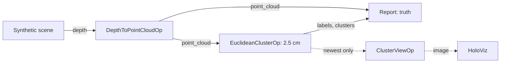

# Clustering

The demo of the [holoscan-clustering](../../modules/clustering/) module. A synthetic depth camera
looks down at boxes and spheres standing on a ground that has already been removed (it has no
depth), with depth noise, flying pixels and missing depth. holoscan-point-cloud's
`DepthToPointCloudOp` deprojects each frame and `EuclideanClusterOp` splits the cloud into objects
on the GPU. A reporter checks every frame against the scene's truth, and with a display the
clusters are drawn in their colors, with their oriented boxes, in HoloViz. It uses the installed
modules the way any other project would: `find_package(holoscan-point-cloud)` and
`find_package(holoscan-clustering)`.



The scene holds a range of objects: a large box with a small one resting on it (touching: one
object), a sphere 5 cm from a tall box and two spheres 4 cm apart (nearly touching: separate
objects), a pole, a wall, a sphere that moves, and a box too small to count. With the default
tolerance and minimum size that is 8 clusters per frame.

## Requirements

- holoscan-point-cloud and holoscan-clustering, installed (see their READMEs), and what they need:
  Holoscan SDK 5.0 with Core and Sensor I/O (Visualization for the display), CUDA 13, CMake 4.0 or
  later and a C++20 compiler.

The demo downloads nothing and needs no models or data: it renders its frames.

## Build and run

From the repository root, after installing both modules into `install/`:

```bash
cmake -S applications/clustering -B build/clustering_demo -G Ninja \
  -DCMAKE_BUILD_TYPE=Release -DCMAKE_PREFIX_PATH="$PWD/install"
cmake --build build/clustering_demo
build/clustering_demo/clustering --count 300                                # synthetic mode
build/clustering_demo/clustering --count 30 --period-ms 10 --display false  # ci mode
```

| Option | Default | |
| --- | --- | --- |
| `--count N` | `300` | Frames |
| `--period-ms N` | `33` | Camera period, 1..1000 ms |
| `--width N --height N` | `640 480` | Image size, 64x48 to 4096x4096 |
| `--tolerance M` | `0.025` | Largest distance within a cluster, meters |
| `--min-size N` | `300` | Smallest cluster, points |
| `--connectivity euclidean\|image` | `euclidean` | Neighbors in space, or in the image (see the module's README) |
| `--display auto\|true\|false` | `auto` | Show the clusters in HoloViz; `auto` when `DISPLAY` or Wayland is set |
| `--timeout-seconds N` | `120` | Allowance beyond the expected run time |
| `--compile-only true\|false` | `false` | Build and check the graph without running it |

| CMake option | Default | |
| --- | --- | --- |
| `CLUSTERING_ENABLE_VISUALIZATION` | `ON` | Build the HoloViz display |
| `BUILD_TESTING` | `OFF` | Build the demo's tests |

`EuclideanClusterOp` cannot send a refused output again, so the source keeps one frame in flight:
it renders the next frame only once the reporter has counted the previous one, and no lossless
queue ever fills. The display branch keeps only the newest clusters (`QueuePolicy::kDropOldest`,
depth 1), so it never holds the clustering back. The view colors each pixel by its cluster, dark
gray for noise and pixels without depth, and draws each cluster's oriented box projected into the
camera.

## What it checks

For each frame the reporter compares, over the points with depth:

- the number of clusters with the number of objects that have at least `--min-size` points:
  exactly equal;
- the labels with the object each pixel shows, objects below the minimum size and flying pixels as
  noise: an adjusted Rand index of at least 0.98;
- each object with the cluster holding most of its points: an intersection over union of at least
  0.95, the centroid within 1 cm of the object's points' and the axis-aligned box within 3 cm;
- each summary with the labels: its id, its point count, and the clusters in decreasing size.

It prints, for example (x86_64, 30 frames):

```text
clustering: frames=30/30 clusters_per_frame=8.0000 wrong_counts=0 min_rand_index=0.9997 min_iou=0.9950 max_centroid_error_m=0.0006 max_box_error_m=0.0157 wrong_objects=0 inconsistent=0
clustering: verdict=PASS
```

The `ci` mode passes only when every frame passes. A stop request (Ctrl+C) ends the run with
`verdict=STOPPED`.

## Tests

With `-DBUILD_TESTING=ON`, `ctest --test-dir build/clustering_demo` runs the demo in each
connectivity and at 1280x720, all checked against the truth; compiles the display graph without a
display; and checks that unusable arguments are usage errors.

## Licenses

Apache-2.0, like the modules it uses. See their NOTICE files.
