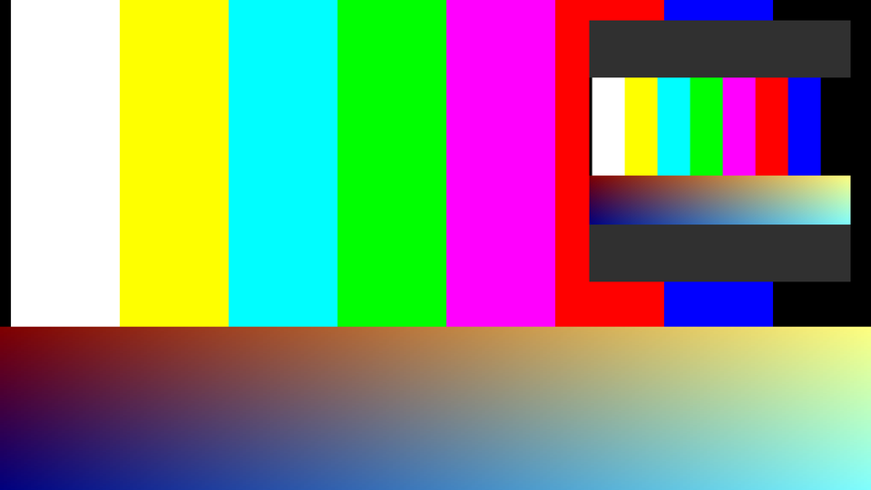

# Color Convert

The demo of the [holoscan-color-convert](../../modules/color-convert/) module. A synthetic camera
sends 1920x1080 NV12 or YUYV frames (BT.709, limited range) of colour bars moving right over
gradients. `ColorConvertOp` turns each frame into RGBA8, and `ResizeOp` letterboxes it into a
640x640 RGBA8 image in the same pass, converting as it resizes. HoloViz shows the full frame with
the small one inset in its top right corner, in a window or rendered offscreen into CUDA memory.
Headless and offscreen, every output is checked against the module's CPU reference, and every
render against its frame. It uses the installed module the way any other project would:
`find_package(holoscan-color-convert)`.



An offscreen render (shown at half size): the converted 1920x1080 frame, and in the corner the
640x640 letterboxed resize, its bands in the fill colour.

## Requirements

- holoscan-color-convert, installed (see [its README](../../modules/color-convert/README.md)), and
  what it needs: Holoscan SDK 5.0 with Core, Sensor I/O and Visualization, CUDA 13, CMake 4.0 or
  later and a C++20 compiler.
- A display for the window; the offscreen and headless modes need none.

## Build and run

From the repository root, after installing the module into `install/`:

```bash
cmake -S applications/color_convert -B build/color_convert -G Ninja \
  -DCMAKE_BUILD_TYPE=Release -DCMAKE_PREFIX_PATH="$PWD/install"
cmake --build build/color_convert
build/color_convert/color_convert --camera nv12 --display window                                   # window mode
build/color_convert/color_convert --camera nv12 --count 60 --period-ms 10 --display offscreen      # offscreen mode
build/color_convert/color_convert --camera yuyv --backend auto --count 60 --period-ms 10 --display none  # ci mode
```

`--help` lists the options: the camera's format and size, the backend (`cuda`, `vic` or `auto`),
`ResizeOp`'s size, sampling and letterbox, and `--image-dir DIR` to write each offscreen render as
a PPM file. `-DCOLOR_CONVERT_APP_ENABLE_VISUALIZATION=OFF` builds it without HoloViz.

The modes in [metadata.json](metadata.json) are the three commands above:

| Mode | What it does |
| --- | --- |
| `window` | Live, at 30 frames per second until the window is closed. Every edge keeps only the newest frame, so a slow display never holds back the camera. Nothing is checked. |
| `offscreen` | HoloViz renders into CUDA memory instead of a window. Every frame's outputs are checked, and every render: outside the inset it must be the converted frame (it is, byte for byte), and the inset must show the letterbox's fill. A check finds which frame a render shows from where its colour bars are. |
| `ci` | Headless and finite, the check CI runs: 60 YUYV frames on the `auto` backend, every output checked against the reference. When `HOLOSCAN_CI_PLATFORM` is set, as on the CI runners, `auto` must have taken the VIC on `jetson` and CUDA on `x86_64`. |

Outside the window, the camera keeps one frame in flight: it sends the next once the last one's
outputs are checked, so nothing is dropped. The `cuda` backend must match the reference byte for
byte; the VIC within its tolerance, a mean difference of 1.5 codes and a 99th percentile of 4 (it
interpolates chroma, so at the bars' edges it differs most).

On a Jetson, the demo links the Vulkan loader first: once VPI has loaded Tegra's EGL driver,
HoloViz can no longer create its Vulkan instance. In a headless container there, leave `DISPLAY`
unset.

## Output

A headless or offscreen run prints which backend each operator ran, the worst difference from the
reference of any frame (mean, 99th percentile and largest difference per byte, and how many bytes
differ), and `PASS` or `FAIL`. It exits 0 on `PASS`, 2 for invalid options, else 1:

```text
color_convert: camera=yuyv 1920x1080 backend=auto (convert ran vic, resize ran vic)
color_convert: auto=vic,vic expected=vic (jetson)
color_convert: frames=60/60 converted: mean=0.673 p99=2 max=181 differing=3428412 resized: mean=0.481 p99=2 max=181 differing=353391
color_convert: verdict=PASS
```

That is the `ci` mode on a Jetson AGX Orin, where `auto` takes the VIC; on x86_64 it takes CUDA,
and every byte matches (`differing=0`).

## Tests

`ctest` in the build folder runs the demo headless on CUDA for both camera formats and every
sampling mode, byte for byte; on `auto`; offscreen, with every render checked; compiles the window
graph; and checks that bad options exit with a usage error.
