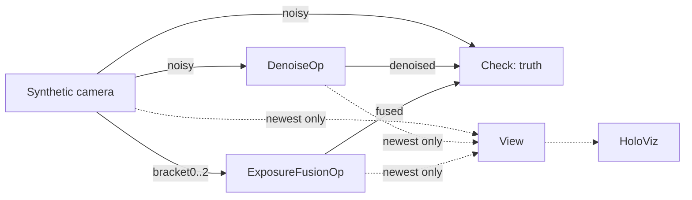

# Denoise

The demo of `DenoiseOp` and `ExposureFusionOp` from the [holoscan-denoise](../../modules/denoise/)
module. A synthetic camera sends noisy low-light frames, in which a disc moves, and three exposure
brackets of a high-dynamic-range scene; `DenoiseOp` cleans the frames and `ExposureFusionOp` fuses
the brackets, on the GPU; a checker measures the result against the scenes' truth; and HoloViz shows
noisy beside denoised, and the brackets beside the fused image. It uses the installed module the
way any other project would: `find_package(holoscan-denoise)`.



## Requirements

- holoscan-denoise, installed (see [its README](../../modules/denoise/README.md)), and what it
  needs: Holoscan SDK 5.0 with Core and Sensor I/O (Visualization for the display), CUDA 13, CMake
  4.0 or later and a C++20 compiler.

The demo downloads nothing and needs no models or data: it renders its frames.

## Build and run

From the repository root, after installing the module into `install/`:

```bash
cmake -S applications/denoise -B build/denoise_demo -G Ninja \
  -DCMAKE_BUILD_TYPE=Release -DCMAKE_PREFIX_PATH="$PWD/install"
cmake --build build/denoise_demo
build/denoise_demo/denoise --count 300                                       # synthetic mode
build/denoise_demo/denoise --count 30 --period-ms 10 --width 640 --height 360 \
  --cut-frame 15 --display false                                             # ci mode
```

| Option | Default | |
| --- | --- | --- |
| `--count N` | `300` | Frames, 1..1000000 |
| `--period-ms N` | `33` | Camera period, 1..1000 ms |
| `--width N --height N` | `1280 720` | Frame size, even, 64x64 to 3840x2160 |
| `--read-noise SIGMA` | `6` | Gaussian read noise, code values |
| `--shot-gain G` | `1` | Shot noise: a value v becomes Poisson(v / G) x G; 0 for none |
| `--speed PX` | `6` | The disc's pixels per frame |
| `--cut-frame N` | none | Switch to a second scene at frame N: a scene cut |
| `--backend cuda\|vpi\|auto` | `cuda` | Where `DenoiseOp` runs |
| `--spatial none\|bilateral\|nlm` | `bilateral`; `none` for `vpi` and `auto` | Spatial filter |
| `--temporal true\|false` | `true` | Motion-adaptive temporal filter |
| `--strength S` | `0.5` | 0..1 |
| `--min-gain DB` | `5` | PSNR gain every settled frame must reach, 0..100 |
| `--display auto\|true\|false\|offscreen` | `auto` | Show the view in HoloViz; `auto` when `DISPLAY` or Wayland is set; `offscreen` renders into CUDA memory and checks what was rendered |
| `--timeout-seconds N` | `120` | Fail when no frame has been checked for this long, 1..3600 s |
| `--compile-only true\|false` | `false` | Build and check the graph without running it |

| CMake option | Default | |
| --- | --- | --- |
| `DENOISE_DEMO_ENABLE_VISUALIZATION` | `ON` | Build the HoloViz display |
| `BUILD_TESTING` | `OFF` | Build the demo's tests |

The modes in [metadata.json](metadata.json) are the two commands above: `synthetic` (default), 300
frames at 1280x720 with the display when there is one, and `ci`, 30 frames at 640x360 with a scene
cut at frame 15, headless.

The window is twice as wide as a frame: on top, the noisy frame on the left and the denoised frame
on the right; below, at half size, the brackets at 1/8, 1 and 32 times the exposure and, on the
right, the fused image. The low-light scene has dark gradients, coloured patches, fine stripes, a
checkerboard and a bright disc moving back and forth; the HDR scene a striped shadow, mid-tones and
a striped window about 13 stops brighter, its stripes drifting a pixel a frame.

The graph is lossless, so it runs on one worker (`graph.partition("denoise").include_all()`;
`--compile-only true` prints `workers=1`). The source sends any output a consumer refused again on
its next tick, and keeps one frame in flight: it renders the next frame only once the checker has
counted the previous one. The display branch, and the offscreen render check after HoloViz, keep
only the newest frames (`QueuePolicy::kDropOldest`, depth 1), so they never hold the pipeline back.

## What it checks

For each frame, once 4 frames of a sequence (from the start or a scene cut) have passed, the PSNR of
the denoised frame against the clean scene must beat the noisy frame's by `--min-gain`. Behind the
disc, where it was in the last 4 frames and no longer is, every frame is checked on its own: the
denoised frame's mean squared error there must be at most the noisy frame's (`worst_trail_ratio`
at most 1), and its mean error there within 1.5 code values of the noisy frame's
(`worst_trail_bias`): noise averages out of that mean, a ghost of the bright disc does not. The
filters stay well inside both (at most 0.61 and 0.61 on the `ci` scene, the vpi backend included),
while a ghost a few code values deep fails the second. The fused image must clip none of the
window and crush none of the shadow, 16 pixels from their edges, and keep their texture (a standard
deviation of at least 6 code values). `DenoiseOp` reports the backend and the engine that ran it;
on a CI runner (`HOLOSCAN_CI_PLATFORM`), the vpi backend, and auto with settings VPI's TNR runs, must
have run on the VIC on a Jetson whose module has VPI, and auto the cuda backend on x86_64. The run
fails when no frame has been checked for `--timeout-seconds`. It prints, for example (x86_64, the
`ci` mode, on a CI runner):

```text
denoise: frames=30/30 backend=cuda engine=cuda spatial=bilateral temporal=on strength=0.50 workers=1
denoise: noisy_psnr=28.99 denoised_psnr=47.92 mean_gain=18.94 worst_gain=16.60 (min 5.00) trail_mse=5.29 input_mse=76.78 worst_trail_ratio=0.09 (max 1.00) worst_trail_bias=0.17 (max 1.50)
denoise: fused_clipped=0 fused_crushed=0 shadow_texture=23.73 window_texture=50.15
denoise: expected_engine=cuda (x86_64)
denoise: verdict=PASS
```

A stop request (Ctrl+C) ends the run with `verdict=STOPPED`.

## Tests

With `-DBUILD_TESTING=ON`, `ctest --test-dir build/denoise_demo` runs the demo with the temporal
filter alone and with each spatial filter, the bilateral filter alone, a scene cut, the auto
backend, 1920x1080, and the vpi backend where the module has it, all checked against the truth;
checks that the graphs (headless, window and offscreen) compile on one worker with no diagnostics;
renders the view offscreen in HoloViz and checks the frames (the noisy half rougher than the
denoised half, the brackets and fused image lit); shows that the checker fails a run that cannot
pass (`--min-gain 60`); and checks that unusable arguments are usage errors. The HoloViz tests are
left out of a build without visualization.

## Licenses

Apache-2.0, like the module it uses. See its NOTICE file.
