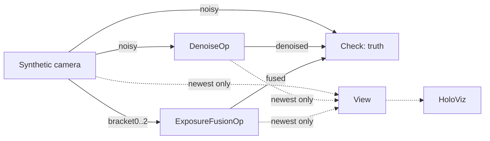

# Denoise

The demo of `DenoiseOp` and `ExposureFusionOp` from the [holoscan-denoise](../../modules/denoise/)
module. A synthetic camera sends noisy low-light frames, in which a disc moves, and three exposure
brackets of a high-dynamic-range scene; `DenoiseOp` cleans the frames and `ExposureFusionOp` fuses
the brackets, on the GPU; a checker measures the result against the scenes' truth; and HoloViz shows
noisy beside denoised, and the brackets beside the fused image. It uses the installed module the
way any other project would: `find_package(holoscan-denoise)`.



## Requirements

- holoscan-denoise, installed (see [its README](../../modules/denoise/README.md)), and what it
  needs: Holoscan SDK 5.0 with Core and Sensor I/O (Visualization for the display), CUDA 13, CMake
  4.0 or later and a C++20 compiler.

The demo downloads nothing and needs no models or data: it renders its frames.

## Build and run

From the repository root, after installing the module into `install/`:

```bash
cmake -S applications/denoise -B build/denoise_demo -G Ninja \
  -DCMAKE_BUILD_TYPE=Release -DCMAKE_PREFIX_PATH="$PWD/install"
cmake --build build/denoise_demo
build/denoise_demo/denoise --count 300                                       # synthetic mode
build/denoise_demo/denoise --count 30 --period-ms 10 --width 640 --height 360 \
  --cut-frame 15 --display false                                             # ci mode
```

| Option | Default | |
| --- | --- | --- |
| `--count N` | `300` | Frames |
| `--period-ms N` | `33` | Camera period, 1..1000 ms |
| `--width N --height N` | `1280 720` | Frame size, even, 64x64 to 3840x2160 |
| `--read-noise SIGMA` | `6` | Gaussian read noise, code values |
| `--shot-gain G` | `1` | Shot noise: a value v becomes Poisson(v / G) x G; 0 for none |
| `--speed PX` | `6` | The disc's pixels per frame |
| `--cut-frame N` | none | Switch to a second scene at frame N: a scene cut |
| `--backend cuda\|vpi\|auto` | `cuda` | Where `DenoiseOp` runs |
| `--spatial none\|bilateral\|nlm` | `bilateral`; `none` for `vpi` and `auto` | Spatial filter |
| `--temporal true\|false` | `true` | Motion-adaptive temporal filter |
| `--strength S` | `0.5` | 0..1 |
| `--min-gain DB` | `5` | PSNR gain every settled frame must reach |
| `--display auto\|true\|false\|offscreen` | `auto` | Show the view in HoloViz; `auto` when `DISPLAY` or Wayland is set; `offscreen` renders into CUDA memory and checks what was rendered |
| `--timeout-seconds N` | `120` | Allowance beyond the expected run time |
| `--compile-only true\|false` | `false` | Build and check the graph without running it |

| CMake option | Default | |
| --- | --- | --- |
| `DENOISE_DEMO_ENABLE_VISUALIZATION` | `ON` | Build the HoloViz display |
| `BUILD_TESTING` | `OFF` | Build the demo's tests |

The modes in [metadata.json](metadata.json) are the two commands above: `synthetic` (default), 300
frames at 1280x720 with the display when there is one, and `ci`, 30 frames at 640x360 with a scene
cut at frame 15, headless.

The window is twice as wide as a frame: on top, the noisy frame on the left and the denoised frame
on the right; below, at half size, the brackets at 1/8, 1 and 32 times the exposure and, on the
right, the fused image. The low-light scene has dark gradients, coloured patches, fine stripes, a
checkerboard and a bright disc moving back and forth; the HDR scene a striped shadow, mid-tones and
a striped window about 13 stops brighter, its stripes drifting a pixel a frame.

The operators cannot send a refused output again, so the source keeps one frame in flight: it
renders the next frame only once the checker has counted the previous one, and no lossless queue
ever fills. The display branch keeps only the newest frames (`QueuePolicy::kDropOldest`, depth 1),
so it never holds the pipeline back.

## What it checks

For each frame, once 4 frames of a sequence (from the start or a scene cut) have passed, the PSNR of
the denoised frame against the clean scene must beat the noisy frame's by `--min-gain`. Behind the
disc, where it was in the last 4 frames and no longer is, the denoised frame's mean squared error
must be below the noisy frame's: no trail. The fused image must clip none of the window and crush
none of the shadow, 16 pixels from their edges, and keep their texture (a standard deviation of at
least 6 code values). It prints, for example (x86_64, the `ci` mode):

```text
denoise: frames=30/30 backend=cuda spatial=bilateral temporal=on strength=0.50
denoise: noisy_psnr=28.99 denoised_psnr=47.92 mean_gain=18.94 worst_gain=16.60 (min 5.00) trail_mse=5.29 input_mse=76.78
denoise: fused_clipped=0 fused_crushed=0 shadow_texture=23.73 window_texture=50.15
denoise: verdict=PASS
```

A stop request (Ctrl+C) ends the run with `verdict=STOPPED`.

## Tests

With `-DBUILD_TESTING=ON`, `ctest --test-dir build/denoise_demo` runs the demo with the temporal
filter alone and with each spatial filter, the bilateral filter alone, a scene cut, the auto
backend, 1920x1080, and the vpi backend where the module has it, all checked against the truth;
renders the view offscreen in HoloViz and checks the frames (the noisy half rougher than the
denoised half, the brackets and fused image lit); compiles the window display graph without a
display; and checks that unusable arguments are usage errors.

## Licenses

Apache-2.0, like the module it uses. See its NOTICE file.
