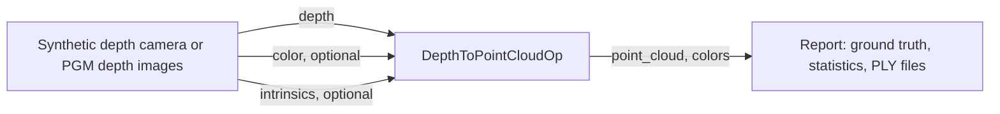

# Depth to Point Cloud

The demo of `DepthToPointCloudOp` from the [holoscan-point-cloud](../../modules/point-cloud/)
module. A source, either a synthetic depth camera with known ground truth or a folder of PGM depth
images, feeds the operator, and a reporter checks every point and color of the clouds against the
truth, measures them and can write them as PLY files. It uses the installed module the way any other
project would: `find_package(holoscan-point-cloud)`.



## Demo

Videos of the demo on synthetic input and on real input go in [tests/video](tests/video).

## Requirements

- holoscan-point-cloud, installed (see [its README](../../modules/point-cloud/README.md)), and what
  it needs: Holoscan SDK 5.0 with Core and Sensor I/O (Testing for the tests), CUDA 13, CMake 4.0 or
  later and a C++20 compiler.

The demo downloads nothing and needs no models. The `images` mode reads your own depth images; every
other mode renders its frames.

## Build and run

From the repository root, after installing the module into `install/`:

```bash
cmake -S applications/depth_to_point_cloud -B build/depth_to_point_cloud -G Ninja \
  -DCMAKE_BUILD_TYPE=Release -DCMAKE_PREFIX_PATH="$PWD/install"
cmake --build build/depth_to_point_cloud
build/depth_to_point_cloud/depth_to_point_cloud --count 300   # synthetic mode
build/depth_to_point_cloud/depth_to_point_cloud --count 30 --period-ms 5 \
  --depth-format millimeters --intrinsics-input true          # ci mode
```

The modes in [metadata.json](metadata.json) are these commands and the `images` mode below:

| Mode | Behavior |
| --- | --- |
| `synthetic` (default) | 300 frames of a synthetic depth camera with color, every point and color checked against ground truth. |
| `images` | Deprojects the PGM depth images in the data directory, `<holohub_data_dir>/depth_to_point_cloud`. |
| `ci` | 30 synthetic uint16 frames with color and per-frame intrinsics, checked against ground truth; a finite headless check that CI runs. |

The synthetic camera sees a tilted plane with a dome, small holes with no depth, and a patch too far
away to be valid, all moving from frame to frame. `--depth-format millimeters` sends it as uint16
millimeters instead of float32 meters, `--host-input true` from host instead of GPU memory, and
`--intrinsics-input true` with per-frame intrinsics. `--ply-dir DIR` writes each cloud as
`DIR/frame_NNNNNN.ply`, which any point-cloud viewer opens. `--help` lists every option.

### Your own depth images

The image source reads binary PGM files, 8- or 16-bit, as depth cameras and image tools save them;
16-bit samples are big-endian, as the format specifies. Give the camera's intrinsics, and the depth
scale if the images are not in millimeters:

```bash
build/depth_to_point_cloud/depth_to_point_cloud --source images --images path/to/pgm/folder \
  --fx 615 --fy 615 --cx 319.5 --cy 239.5 --ply-dir .
```

## Output

Each run prints the frame and point counts, the valid points and their depth range and, for
synthetic input, how many points and colors differ from the truth and the largest error. A gap in
the frame ids fails the run and is printed too. Then comes a `verdict`: `PASS`, `FAIL`, or `STOPPED`
when an interrupt ends the run early. It exits 0 on `PASS`, 2 for invalid options, else 1:

```text
depth_to_point_cloud: frames=30/30 points=9216000 valid=8878080 depth_m=[1.040, 2.196] truth: wrong_points=0 wrong_colors=0 max_error_m=0.00e+00
depth_to_point_cloud: verdict=PASS
```

## Performance

On an RTX 5090 (driver 595.91.07) with SDK 5.0.0 and CUDA 13.2, the deprojection kernel takes a
median of 6.5 µs per 1280x720 float32 frame and 6.4 µs per uint16 frame, colors included. Measured
with Nsight Systems 2026.4.1 over 200 frames, from the kernel summary
(`nsys stats --report cuda_gpu_kern_sum`) of:

```bash
nsys profile -t cuda --sample=none --cpuctxsw=none -o depth \
  build/depth_to_point_cloud/depth_to_point_cloud --width 1280 --height 720 --count 200 --depth-format meters
nsys profile -t cuda --sample=none --cpuctxsw=none -o depth_mm \
  build/depth_to_point_cloud/depth_to_point_cloud --width 1280 --height 720 --count 200 --depth-format millimeters
```

## Tests

With `-DBUILD_TESTING=ON`, `ctest` checks the reporter's frame-id check through the SDK's operator
test harness, and the demo's runs: the synthetic camera in float32 and uint16, from GPU and host
memory, with configured and per-frame intrinsics and a narrower depth range, every point and color
against ground truth; a folder of 16-bit PGM depth images, once and looped; PLY output; and the exit
status and verdict of failed, timed-out, stopped and invalid runs, and of a run without managed
signal handling. The PGM file test in [tests/host/](tests/host/) needs neither the
SDK nor a GPU, and also runs on the hosted CI job. None of it needs data.

## Licenses

Apache-2.0. The module's README lists the licenses of what it uses.
