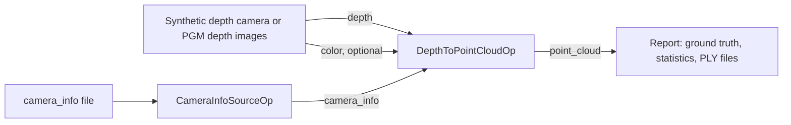

# Depth to Point Cloud

The demo of `DepthToPointCloudOp` from the [holoscan-point-cloud](../../modules/point-cloud/)
module. A source, either a synthetic depth camera with known ground truth or a folder of PGM depth
images, feeds the operator, the camera comes from a ROS `camera_info` file through
`CameraInfoSourceOp` from [holoscan-messages](../../modules/messages/), and a reporter checks every
point and color of the `PointCloud` messages against the truth, measures them and can write them as
PLY files. It uses the installed modules the way any other project would:
`find_package(holoscan-point-cloud)`.



## Demo

Videos of the demo on synthetic input and on real input go in [tests/video](tests/video).

## Requirements

- holoscan-point-cloud 2.0 and holoscan-messages 1.0, installed (see
  [its README](../../modules/point-cloud/README.md)), and what they need: Holoscan SDK 5.0 with Core
  and Sensor I/O (Testing for the tests), CUDA 13, CMake 4.0 or later and a C++20 compiler.

The demo downloads nothing and needs no models. The `images` mode reads your own depth images and
their `camera_info` file; every other mode renders its frames and, unless
`--camera-info-per-frame true`, writes the synthetic camera's `camera_info` file to a folder of its
own in the temporary folder, removing it when the run ends.

## Build and run

From the repository root, after installing the modules into `install/`:

```bash
cmake -S applications/depth_to_point_cloud -B build/depth_to_point_cloud -G Ninja \
  -DCMAKE_BUILD_TYPE=Release -DCMAKE_PREFIX_PATH="$PWD/install"
cmake --build build/depth_to_point_cloud
build/depth_to_point_cloud/depth_to_point_cloud --count 300   # synthetic mode
build/depth_to_point_cloud/depth_to_point_cloud --count 30 --period-ms 5 \
  --depth-format millimeters                                  # ci mode
```

The modes in [metadata.json](metadata.json) are these commands and the `images` mode below:

| Mode | Behavior |
| --- | --- |
| `synthetic` (default) | 300 frames of a synthetic depth camera with color, every point and color checked against ground truth. |
| `images` | Deprojects the PGM depth images in the data directory, `<holohub_data_dir>/depth_to_point_cloud`, with the `camera_info.yaml` next to them. |
| `ci` | 30 synthetic uint16 frames with color and the camera from a `camera_info` file, checked against ground truth; a finite headless check that CI runs. |

The synthetic camera sees a tilted plane with a dome, small holes with no depth, and a patch too far
away to be valid, all moving from frame to frame. Its camera goes to `CameraInfoSourceOp` as a
`camera_info` file written at the start of the run. `--depth-format millimeters` sends the frames
as uint16 millimeters instead of float32 meters, `--host-input true` from host instead of GPU
memory, and `--camera-info-per-frame true` sends the camera info with every frame instead, its
focal length changing from frame to frame. `--ply-dir DIR` writes each cloud as
`DIR/frame_NNNNNN.ply`, `NNNNNN` the frame from 0, which any point-cloud viewer opens. `--help`
lists every option.

### Your own depth images

The image source reads binary PGM files, 8- or 16-bit, as depth cameras and image tools save them;
16-bit samples are big-endian, as the format specifies. Give the camera's ROS `camera_info` file,
for images of the depth images' size, and the depth scale in meters per sample value if the images
are not in millimeters; 8-bit images always need it:

```bash
build/depth_to_point_cloud/depth_to_point_cloud --source images --images path/to/pgm/folder \
  --camera-info path/to/depth.yaml --ply-dir .
```

The camera must be undistorted or rectified, without skew: the demo refuses one whose distortion
coefficients are not all zero, or that has a skew.

## Output

Each run prints the clouds and frames, the frames that came before the first camera info (which
give no cloud; at most one may), the point counts, the valid points and their depth range and, for synthetic input,
how many points and colors differ from the truth and the largest error. Every frame after the
first camera info must give a cloud; a gap in the frame ids fails the run and is printed too. Then
comes a `verdict`: `PASS`, `FAIL`, or `STOPPED` when an interrupt ends the run early. It exits 0 on
`PASS`, 2 for invalid options, else 1:

```text
depth_to_point_cloud: frames=30/30 before_camera_info=0 points=9216000 valid=8878080 depth_m=[1.040, 2.196] truth: wrong_points=0 wrong_colors=0 max_error_m=0.00e+00
depth_to_point_cloud: verdict=PASS
```

## Performance

On an RTX 5090 (driver 595.91.07) with SDK 5.0.0 and CUDA 13.2, the deprojection kernel takes a
median of 6.5 µs per 1280x720 float32 frame and 6.4 µs per uint16 frame, colors included. Measured
with Nsight Systems 2026.4.1 over 200 frames, from the kernel summary
(`nsys stats --report cuda_gpu_kern_sum`) of:

```bash
nsys profile -t cuda --sample=none --cpuctxsw=none -o depth \
  build/depth_to_point_cloud/depth_to_point_cloud --width 1280 --height 720 --count 200 --depth-format meters
nsys profile -t cuda --sample=none --cpuctxsw=none -o depth_mm \
  build/depth_to_point_cloud/depth_to_point_cloud --width 1280 --height 720 --count 200 --depth-format millimeters
```

## Tests

With `-DBUILD_TESTING=ON`, `ctest` checks the reporter's frame-id and message checks through the
SDK's operator test harness, and the demo's runs: the synthetic camera in float32 and uint16, from
GPU and host memory, with the camera from a `camera_info` file and with every frame and a narrower
depth range, every point and color against ground truth; a folder of 16-bit PGM depth images with
its `camera_info` file, once and looped; PLY output; cameras that are missing, unreadable, of
another size, raw or skewed; and the exit status and verdict of failed, timed-out, stopped and
invalid runs, and of a run without managed signal handling. The PGM file test in
[tests/host/](tests/host/) needs neither the SDK nor a GPU, and also runs on the hosted CI job.

`depth_app_real_recordings` runs the demo on the local recordings, each clip's depth images with
its `depth.yaml`, when `HOLOSCAN_TEST_DATA` names the folder that holds `stereo-camera/`; it is
skipped otherwise, as in CI. No other test needs data.

## Licenses

Apache-2.0. The module's README lists the licenses of what it uses.
