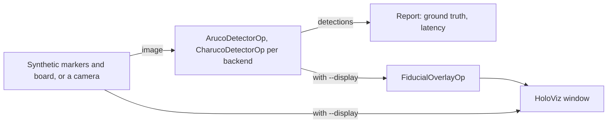

# Fiducial Detection

The demo of the [holoscan-fiducials](../../modules/fiducials/) module. It renders synthetic scenes
of ArUco markers and of a ChArUco board at known poses, fans each frame out to an `ArucoDetectorOp`
or a `CharucoDetectorOp` per selected backend (`cpu`, `cuda`, or `auto`, which the module picks for
the platform), checks every marker, chessboard corner and pose against the scene's ground truth,
and can show the first detector's results on a HoloViz display through `FiducialOverlayOp`. It can
also read a V4L2 camera instead. It uses the installed module the way any other project would:
`find_package(holoscan-fiducials)`.



## Requirements

- holoscan-fiducials, installed (see [its README](../../modules/fiducials/README.md)), and what it
  needs: Holoscan SDK 5.0 with Core, Sensor I/O and Visualization, CUDA 13, CMake 4.0 or later and
  a C++20 compiler.
- A display for the HoloViz window; without one, run with `--display false`.
- For the `camera` mode only: a V4L2 camera offering YUYV at the chosen size, and a printed board
  or markers.

## Build and run

From the repository root, after installing the module into `install/`:

```bash
cmake -S applications/fiducial_detection -B build/fiducial_detection -G Ninja \
  -DCMAKE_BUILD_TYPE=Release -DCMAKE_PREFIX_PATH="$PWD/install"
cmake --build build/fiducial_detection
build/fiducial_detection/fiducial_detection --scene both --backend all,auto --count 300   # synthetic
build/fiducial_detection/fiducial_detection --scene both --backend all,auto --count 30 \
  --period-ms 10 --display false                                                          # ci
build/fiducial_detection/fiducial_detection --source camera --scene charuco --count 0     # camera
```

The modes in [metadata.json](metadata.json) are these three commands:

| Mode | Behavior |
| --- | --- |
| `synthetic` (default) | Six moving markers and a moving 5x7 ChArUco board, every backend and auto, checked against ground truth; the markers' detections displayed when there is a display. |
| `camera` | A 5x7 `DICT_4X4_50` ChArUco board (4 cm squares, 3 cm markers) in a live camera, on the GPU, displayed, until the window is closed or Ctrl-C. Local only: CI does not run it. |
| `ci` | 30 frames of each scene through every backend and auto, verified against ground truth; a finite headless check that CI runs. |

`--help` lists the options. `--scene` takes `aruco`, `charuco` or `both`; `--dictionary` picks the
markers' dictionary (any of the module's, such as `DICT_APRILTAG_36h11`), and `--board`,
`--square-length`, `--board-marker-length`, `--board-dictionary` and `--legacy-pattern` describe
the board. With the camera, `--intrinsics fx,fy,cx,cy` gives poses, and `--marker-length` the
markers' size; the board's pose needs only the intrinsics. `--device-input true` sends synthetic
frames in GPU memory. A backend that reads the other memory copies each frame's gray image, and its
detector logs that once. `-DFIDUCIAL_DETECTION_ENABLE_VISUALIZATION=OFF` builds it without HoloViz.

Synthetic frames reach every detector in order, on lossless edges, so that each is checked against
its own scene. Camera frames are live: every edge keeps only the newest sample, so a slow consumer
never holds the camera or the detectors back.

## Output

Each run prints a line per scene and backend with its frame, marker and corner counts, detection
latency (mean, median, 95th percentile, maximum) and ground-truth errors, then `PASS`, `FAIL`, or
`STOPPED` when an interrupt or a closed window ends it early (`DONE` for the camera). It exits 0 on
`PASS` or `DONE`, 2 for invalid options, else 1. When `HOLOSCAN_CI_PLATFORM` is set, as on the CI
runners, `auto` must have chosen `cuda`.

```text
fiducial_detection: aruco backend=cpu frames=30/30 markers=180 ... truth: missed=0 extra=0 misplaced=0/180 ...
fiducial_detection: aruco backend=cuda frames=30/30 markers=180 ... truth: missed=0 extra=0 misplaced=0/180 ...
fiducial_detection: charuco backend=auto:cuda frames=30/30 markers=510 corners=720 ... without_pose=0 ...
fiducial_detection: verdict=PASS
```

A marker is misplaced when a corner is more than 0.5 px or its pose more than 1 % of its distance
or 2 degrees from the truth; a chessboard corner when it is more than 0.5 px off.

The display draws each marker's outline and axes, each chessboard corner as a cross, and the
board's axes, with the markers' ids and the board's corner count as labels.
