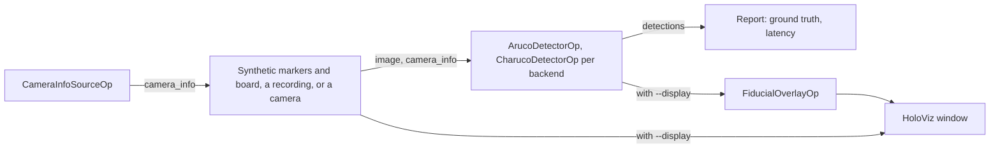

# Fiducial Detection

The demo of the [holoscan-fiducials](../../modules/fiducials/) module. It renders synthetic scenes
of ArUco markers and of a ChArUco board at known poses, fans each frame out to an `ArucoDetectorOp`
or a `CharucoDetectorOp` per selected backend (`cpu`, `cuda`, or `auto`, which the module picks for
the platform), checks every marker, chessboard corner and pose against the scene's ground truth,
and can show the first detector's results on a HoloViz display through `FiducialOverlayOp`. The
poses come from the camera's ROS camera_info file, sent by holoscan-messages' `CameraInfoSourceOp`:
for the synthetic scenes, a file of their camera written at start into a new temporary folder that
is removed when the demo ends. It can also read a V4L2 camera, or a recording's color frames,
instead. It uses the installed modules the way any other project would:
`find_package(holoscan-fiducials)`.



## Requirements

- holoscan-fiducials and holoscan-messages, installed (see
  [its README](../../modules/fiducials/README.md)), and what they need: Holoscan SDK 5.0 with Core, Sensor I/O and Visualization, CUDA 13, CMake 4.0 or later and
  a C++20 compiler.
- A display for the HoloViz window; without one, run with `--display false`.
- For the `camera` mode only: a V4L2 camera offering YUYV at the chosen size, a printed board
  or markers, and, for poses, the camera's ROS camera_info file for that size.

## Build and run

From the repository root, after installing holoscan-messages and holoscan-fiducials into
`install/`:

```bash
cmake -S applications/fiducial_detection -B build/fiducial_detection -G Ninja \
  -DCMAKE_BUILD_TYPE=Release -DCMAKE_PREFIX_PATH="$PWD/install"
cmake --build build/fiducial_detection
build/fiducial_detection/fiducial_detection --scene both --backend all,auto --count 300   # synthetic
build/fiducial_detection/fiducial_detection --scene both --backend all,auto --count 30 \
  --period-ms 10 --display false                                                          # ci
build/fiducial_detection/fiducial_detection --source camera --scene charuco --count 0 \
  --display true                                                                          # camera
```

The modes in [metadata.json](metadata.json) are these three commands:

| Mode | Behavior |
| --- | --- |
| `synthetic` (default) | Six moving markers and a moving 5x7 ChArUco board, every backend and auto, checked against ground truth; the markers' detections displayed when there is a display. |
| `camera` | A 5x7 `DICT_4X4_50` ChArUco board (4 cm squares, 3 cm markers) in a live camera, on the GPU, displayed, until the window is closed or Ctrl-C; add `--camera-info PATH` for its pose. Local only: CI does not run it. |
| `ci` | 30 frames of each scene through every backend and auto, verified against ground truth, on one worker; a finite headless check that CI runs. |

`--help` lists the options. `--scene` takes `aruco`, `charuco` or `both`; `--dictionary` picks the
markers' dictionary (any of the module's, such as `DICT_APRILTAG_36h11`), and `--board`,
`--square-length`, `--board-marker-length`, `--board-dictionary` and `--legacy-pattern` describe
the board. With the camera, `--camera-info PATH` (a ROS camera_info file of the camera's
`--width` x `--height`) gives poses, and `--marker-length` the markers' size; without it there are
no poses. The synthetic scenes have their own camera and markers, so they refuse `--device`,
`--camera-info` and `--marker-length`. `--recording DIR` reads a recording's color frames
instead (`index.csv`, 8-bit RGB PPM images and the color camera's `rgb.yaml`) and passes when
every backend finds what the first one finds, frame by frame. `--device-input true` sends
synthetic or recorded frames in GPU memory. A backend that reads the other memory copies each frame's gray image, and its
detector logs that once. `-DFIDUCIAL_DETECTION_ENABLE_VISUALIZATION=OFF` builds it without HoloViz.

Synthetic and recorded frames reach every detector in order, on lossless edges and with their
camera info, so that each is checked against its own scene; the whole graph runs on one worker
(`--compile-only true` prints the count). Camera frames are live: every edge keeps only the newest sample, so a slow consumer
never holds the camera or the detectors back.

CI runs the synthetic data only. With `HOLOSCAN_TEST_DATA` naming the folder of local recordings
(`stereo-camera/<clip>/`, each with `rgb.yaml`), the `fiducial_app_recordings` test runs every
recording through the `cpu` and `cuda` backends: they show no marker or board, so each backend
must find none, and both the same; without the variable it is skipped.

## Output

Each run prints a line per scene and backend with its frame, marker and corner counts, detection
latency (mean, median, 95th percentile, maximum, without the first frame, which warms up), CPU
waits and bytes copied per frame, and ground-truth errors (a marker or board found without a pose,
`without_pose`, fails it), then `PASS`, `FAIL`, or
`STOPPED` when an interrupt or a closed window ends it early (`DONE` for the camera, which needs at
least one frame; with a finite `--count` it ends after that many frames). It exits 0 on
`PASS` or `DONE`, 2 for invalid options, else 1. When `HOLOSCAN_CI_PLATFORM` is set, as on the CI
runners, `auto` must have chosen `cuda`.

```text
fiducial_detection: aruco backend=cpu frames=30/30 markers=180 ... truth: missed=0 extra=0 misplaced=0/180 ...
fiducial_detection: aruco backend=cuda frames=30/30 markers=180 ... truth: missed=0 extra=0 misplaced=0/180 ...
fiducial_detection: charuco backend=auto:cuda frames=30/30 markers=510 corners=720 ... without_pose=0 ...
fiducial_detection: verdict=PASS
```

A marker is misplaced when a corner is more than 0.5 px or its pose more than 1 % of its distance
or 2 degrees from the truth; a chessboard corner when it is more than 0.5 px off.

The display draws each marker's outline and axes, each chessboard corner as a cross, and the
board's axes, with the markers' ids and the board's corner count as labels.
