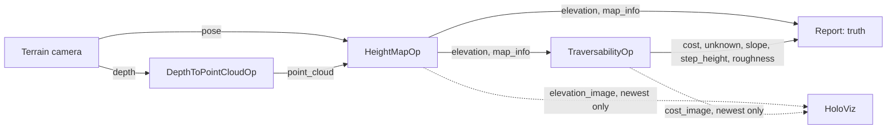

# Height Map

The demo of the [holoscan-height-map](../../modules/height-map/) module. A synthetic depth camera,
1.1 m up and tilted 35 degrees down, drives along a course with a 15 degree ramp, four 8 cm steps, a
30 cm box and a 20 cm deep pit, swaying a little in yaw, with depth noise; holoscan-point-cloud's
`DepthToPointCloudOp` deprojects each frame, `HeightMapOp` maps the clouds with the camera's pose
into an elevation map that follows the camera, and `TraversabilityOp` computes slope, step height,
roughness and a cost. A reporter checks every map against the course's truth, and HoloViz shows the
elevation beside the cost. It uses the installed modules the way any other project would:
`find_package(holoscan-point-cloud)` and `find_package(holoscan-height-map)`.



## Requirements

- holoscan-point-cloud and holoscan-height-map, installed (see their READMEs), and what they need:
  Holoscan SDK 5.0 with Core and Sensor I/O (Visualization for the display), CUDA 13, CMake 4.0 or
  later and a C++20 compiler.

The demo downloads nothing and needs no models or data: it renders its frames.

## Build and run

From the repository root, after installing both modules into `install/`:

```bash
cmake -S applications/height_map -B build/height_map -G Ninja \
  -DCMAKE_BUILD_TYPE=Release -DCMAKE_PREFIX_PATH="$PWD/install"
cmake --build build/height_map
build/height_map/height_map --count 300                                # synthetic mode
build/height_map/height_map --count 60 --period-ms 10 --display false  # ci mode
```

| Option | Default | |
| --- | --- | --- |
| `--count N` | `300` | Frames; the camera drives 1 cm a frame from x = 0.5 m |
| `--period-ms N` | `33` | Camera period, 1..1000 ms |
| `--width N --height N` | `640 480` | Depth image size, 64x48 to 4096x4096 |
| `--map-cells N` | `200` | The map's side in cells, 32..1024 |
| `--resolution M` | `0.04` | The cells' side in meters, 0.01..0.2 |
| `--elevation fused\|mean\|max` | `fused` | The elevation layer: the fused estimate, or the latest observation's mean or highest point |
| `--display auto\|true\|false\|offscreen` | `auto` | Show the elevation and cost in HoloViz; `auto` when `DISPLAY` or Wayland is set; `offscreen` renders into CUDA memory and checks what was rendered |
| `--timeout-seconds N` | `120` | Allowance beyond the expected run time |
| `--compile-only true\|false` | `false` | Build and check the graph without running it |

| CMake option | Default | |
| --- | --- | --- |
| `HEIGHT_MAP_ENABLE_VISUALIZATION` | `ON` | Build the HoloViz display |
| `BUILD_TESTING` | `OFF` | Build the demo's tests |

The window shows the map from above, x to the right and y up, the camera in its middle looking
right: on the left the elevation, from dark blue at the pit's floor (-0.2 m) through cyan (the
ground) to red at the ramp's top (0.4 m); on the right the cost, green where it is free, yellow on
the ramp, red at the steps', the box's and the pit's edges. Cells never seen, such as those behind
the box and the camera, are dark gray.

The operators cannot send a refused output again, so the camera keeps one frame in flight: it
renders the next frame only once the reporter has counted the previous one, and no lossless queue
ever fills. The display branch keeps only the newest map (`QueuePolicy::kDropOldest`, depth 1), so
it never holds the pipeline back.

## What it checks

For each map the reporter compares, with the course's analytic heights:

- the elevation of every known cell more than 1.5 cells from a height jump: median error at most
  4 mm and 95th percentile at most 2 cm (2 and 4 cm with `--elevation max`, whose highest points
  lie above the surface by the noise);
- the slope on the ramp, where the plane fit sees only the ramp: median error at most 1 degree;
- the steps: the largest step height near each rise, in each row, against the 8 cm steps: median
  error at most 2 cm;
- the box's near rim, which faces the camera: at least 90 % of its known cells lethal (cost 1;
  50 % with the mean or highest point, which hold only the latest observation);
- the free ground away from every feature: 95th percentile of the cost at most 0.3;
- the unknown mask against the cost, and the other layers present where the cost is known;
- the window: centered on the camera, on the lattice through the map frame's origin, as `map_info`
  says; and at least 10 % of the map known.

It prints, for example (x86_64, 60 frames):

```text
height_map: frames=60/60 elevation_median_m=0.0008 elevation_p95_m=0.0055 slope_error_deg=0.0966 step_error_m=0.0015 flat_cost_p95=0.1139 lethal_rim=1.0000 known_share=0.1392 window_wrong=0 mask_wrong=0
height_map: verdict=PASS
```

The values are the worst over the frames. The `ci` mode passes only when every frame passes. A stop
request (Ctrl+C) ends the run with `verdict=STOPPED`.

## Tests

With `-DBUILD_TESTING=ON`, `ctest --test-dir build/height_map` runs the demo with each elevation
layer, with a finer 500x500 map, and at 1280x720, all checked against the truth; renders both maps
offscreen in HoloViz and checks the frames; compiles the window display graph without a display;
and checks that unusable arguments are usage errors.

## Licenses

Apache-2.0, like the modules it uses. See their NOTICE files.
