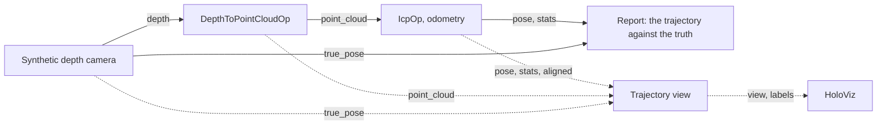

# ICP Odometry

The demo of `IcpOp` from the [holoscan-icp](../../modules/icp/) module, as a depth odometry. A
synthetic depth camera moves along a known, closed path through a room of walls, boxes and
spheres; `DepthToPointCloudOp` from [holoscan-point-cloud](../../modules/point-cloud/) turns each
depth image into a point cloud, and `IcpOp` registers each cloud to the one before on the GPU and
accumulates the camera's pose. A reporter checks the estimated trajectory against the true one, and
a HoloViz window can show both, and how the current frame aligns with the previous one. It uses the
installed modules the way any other project would: `find_package(holoscan-icp)` and
`find_package(holoscan-point-cloud)`.



## Requirements

- holoscan-icp and holoscan-point-cloud, installed (see their READMEs), and what they need: Holoscan
  SDK 5.0 with Core, Sensor I/O and, for the display, Visualization; CUDA 13, CMake 4.0 or later and
  a C++20 compiler.

The demo downloads nothing and needs no data: it renders its frames.

## Build and run

From the repository root, after installing both modules into `install/`:

```bash
cmake -S applications/icp_odometry -B build/icp_odometry -G Ninja \
  -DCMAKE_BUILD_TYPE=Release -DCMAKE_PREFIX_PATH="$PWD/install"
cmake --build build/icp_odometry
build/icp_odometry/icp_odometry                                   # synthetic mode
build/icp_odometry/icp_odometry --width 320 --height 240 --count 150 \
  --period-ms 2 --display false                                   # ci mode
```

The modes in [metadata.json](metadata.json) are these commands:

| Mode | Behavior |
| --- | --- |
| `synthetic` (default) | A 640x480 camera at 30 frames per second, around its 300-frame path once; the display is on when a display server is available. |
| `ci` | A 320x240 camera around its path in 150 frames, as fast as the odometry goes, headless; a finite check that CI runs. |

The camera's depth has time-of-flight noise: 0.5 mm plus 0.5 mm per square meter of depth. The
path is about 5 m long: the camera sways sideways and up and down, moves forward and back, yaws,
pitches and rolls, and ends where it started. `--path-frames N` spreads it over `N` frames while
`--count` frames run, for runs that cover part of it. The ICP options are those of the module
(`--method`, `--voxel-size`, `--max-distance`, `--min-distance`, `--normal-radius`,
`--max-iterations`, `--robust`, `--robust-scale`); by default, point-to-plane on 2 cm voxels, with
correspondences from 10 cm down to 3 cm. `--help` lists every option.

The display (`--display true`, or `auto` with a display server) shows the path from above, the true
one in green and the estimate in orange, beside the current frame's alignment: the previous frame's
depth in gray, and the current cloud moved into the previous frame by `IcpOp`, colored by its
distance to the previous cloud, green within 2 cm, yellow within 5 cm, red beyond. Text gives the
frame's pose error, fitness, RMSE and iterations. The display only watches: its inputs keep the
newest frames and never hold back the odometry. Drawing copies each frame's clouds to the host, which
the demo logs once.

## Output

Each run prints how far the camera went, the final position and rotation error of the estimated
pose against the true one, the drift (the final position error over the path's length), the
absolute trajectory error (the RMS of the position errors), the frames whose registration did not
converge, and the mean fitness, RMSE and iterations. Then comes a `verdict`: `PASS` when every frame
converged and the drift and final rotation error are within `--max-drift-percent` (2) and
`--max-rotation-error-deg` (1.5), `FAIL`, or `STOPPED` when an interrupt ends the run early. It exits
0 on `PASS`, 2 for invalid options, else 1:

```text
icp_odometry: frames=150/150 320x240 path_m=4.91 final_error_mm=28.37 final_rotation_error_deg=0.40 drift_percent=0.58 ate_rmse_mm=13.33 max_error_mm=28.37 unconverged=0 mean_fitness=0.97 mean_rmse_mm=13.90 mean_iterations=17.72
icp_odometry: verdict=PASS
```

The module's README has the time per frame at three resolutions on x86 and Jetson.

## Tests

With `-DBUILD_TESTING=ON`, `ctest` runs the demo against the truth: point-to-plane at 320x240 around
the whole path and at 640x480 over part of it, point-to-point with wider limits, and noiseless clouds
at full resolution; the display's graph, compiled but not run; and the exit status and verdict of runs
that miss their limits, of frames that cannot converge, and of invalid options. None of it needs data.

## Licenses

Apache-2.0. The modules' READMEs list the licenses of what they use.
