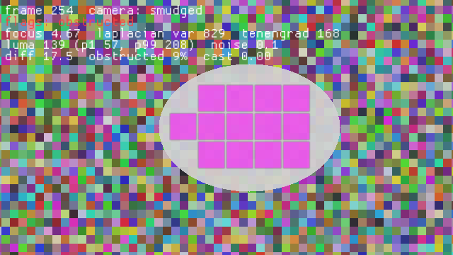

# Image Quality

The demo of the [holoscan-image-quality](../../modules/image-quality/) module. A synthetic camera
films a moving scene and cycles through segments that spoil it: sharp, blurred (Gaussian, sigma 3),
dark (a quarter of the exposure), noisy (sigma 12 per channel), frozen (one frame repeated), smudged
(a haze on the lens that stays put while the scene moves) and tinted (red up 30 %, blue down 25 %).
`ImageQualityOp` checks every frame, and a reporter compares its flags with what the frame's segment
must give: `blurred`, `underexposed`, `noisy`, `frozen` on every repeat, `obstructed` once the smudge
has lasted the obstruction window, `color_cast`, and nothing at all for the sharp segment or anywhere
else. HoloViz shows the image, the tile overlay (red for blurred tiles, magenta for obstructed ones,
faint yellow for low-texture ones) and the metrics. It uses the installed module the way any other
project would: `find_package(holoscan-image-quality)`.



A frame of the smudged segment as HoloViz rendered it offscreen (`--display offscreen --snapshot`):
the tiles under the haze have been low-texture for the whole window and are flagged obstructed.

## Requirements

- holoscan-image-quality, installed (see [its README](../../modules/image-quality/README.md)), and
  what it needs: Holoscan SDK 5.0 with Core, Sensor I/O and Visualization (Testing for the tests),
  CUDA 13, CMake 4.0 or later and a C++20 compiler.
- For the window, a display; without one, run with `--display false` or `--display offscreen`.

## Build and run

From the repository root, after installing the module into `install/`:

```bash
cmake -S applications/image_quality -B build/image_quality -G Ninja \
  -DCMAKE_BUILD_TYPE=Release -DCMAKE_PREFIX_PATH="$PWD/install"
cmake --build build/image_quality
build/image_quality/image_quality --count 630                                             # display mode
build/image_quality/image_quality --count 315 --period-ms 10 --display offscreen --snapshot image_quality.ppm  # offscreen mode
build/image_quality/image_quality --count 560 --segment-frames 40 --period-ms 5 --display false  # ci mode
```

`--help` lists the options: the frame count, period and size, frames per segment, the obstruction
window (`--obstruction-frames`, 30, which must be shorter than a segment, 45), and
`--device-input true` for frames in GPU memory. With host frames the operator logs once that it
copies each frame to the GPU.

The modes in [metadata.json](metadata.json) are the three commands above: `display`, in a window
when there is a display; `offscreen`, where HoloViz renders into GPU memory and a checker requires
every rendered frame to show the scene, some to show the text and some to show the overlay's
magenta over the smudge and nowhere else, then saves the frame with the most of it; and `ci`, the
finite headless check CI runs.

## Output

Each run prints a line per segment with its frames, the frames whose flags were wrong, the flags
seen and the mean of a few metrics, then `PASS`, `FAIL`, or `STOPPED` when an interrupt or a closed
window ends it early. It exits 0 on `PASS`, 2 for invalid options, else 1:

```text
image_quality: segment=sharp frames=80 wrong=0 flags=ok focus=4.589 mean_luma=127.9 noise_sigma=0.06 color_cast=0.010
image_quality: segment=blurred frames=80 wrong=0 flags=blurred focus=0.083 mean_luma=127.8 noise_sigma=0.35 color_cast=0.014
image_quality: segment=dark frames=80 wrong=0 flags=underexposed focus=4.452 mean_luma=31.9 noise_sigma=0.06 color_cast=0.012
image_quality: segment=noisy frames=80 wrong=0 flags=noisy focus=4.610 mean_luma=126.9 noise_sigma=8.04 color_cast=0.005
image_quality: segment=frozen frames=80 wrong=0 flags=frozen focus=4.591 mean_luma=126.4 noise_sigma=0.06 color_cast=0.004
image_quality: segment=smudged frames=80 wrong=0 flags=obstructed focus=4.621 mean_luma=139.0 noise_sigma=0.06 color_cast=0.006
image_quality: segment=tinted frames=80 wrong=0 flags=color_cast focus=4.579 mean_luma=134.7 noise_sigma=0.06 color_cast=0.269
image_quality: frames=560/560 wrong=0
image_quality: verdict=PASS
```

A frame's `flags` is the union over the segment: the frozen segment's first frame and the smudged
segment's first 29 frames have none, as they must. Up to ten wrong frames are listed by number.

## Tests

With `-DBUILD_TESTING=ON`, `ctest` runs the demo: two cycles of short segments from host memory,
one from GPU memory, one at 1280x720, every frame's flags checked; the offscreen render check with
a snapshot; that the window graph compiles; and the exit status of invalid options.

## Licenses

Apache-2.0. The module's README lists the licenses of what it uses.
