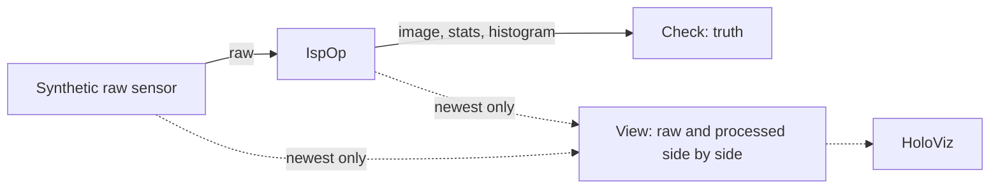

# ISP

The demo of `IspOp` from the [holoscan-isp](../../modules/isp/) module. A synthetic raw sensor,
mosaicked with known black levels, white balance gains and vignetting, sends Bayer frames as a GMSL
or CSI camera would; `IspOp` turns them into RGB on the GPU; a checker measures every frame's PSNR
against the sensor's truth and checks its histograms; and HoloViz shows the raw mosaic beside the
processed image. It uses the installed module the way any other project would:
`find_package(holoscan-isp)`.



## Requirements

- holoscan-isp, installed (see [its README](../../modules/isp/README.md)), and what it needs:
  Holoscan SDK 5.0 with Core and Sensor I/O (Visualization for the display), CUDA 13, CMake 4.0 or
  later and a C++20 compiler.

The demo downloads nothing and needs no models or data: it renders its frames.

## Build and run

From the repository root, after installing the module into `install/`:

```bash
cmake -S applications/isp -B build/isp_demo -G Ninja \
  -DCMAKE_BUILD_TYPE=Release -DCMAKE_PREFIX_PATH="$PWD/install"
cmake --build build/isp_demo
build/isp_demo/isp --count 300                                                     # synthetic mode
build/isp_demo/isp --count 30 --period-ms 10 --width 640 --height 480 --display false  # ci mode
```

| Option | Default | |
| --- | --- | --- |
| `--count N` | `300` | Frames |
| `--period-ms N` | `33` | Sensor period, 1..1000 ms |
| `--width N --height N` | `1280 720` | Frame size, 16x16 to 4096x4096 |
| `--pattern RGGB\|BGGR\|GRBG\|GBRG` | `RGGB` | Bayer pattern |
| `--bits N` | `12` | Bits per sample, 2..16; 8 or fewer are sent as uint8, more as uint16 |
| `--packing none\|raw10\|raw12` | `none` | Send MIPI CSI-2 packed rows instead |
| `--demosaic malvar\|bilinear` | `malvar` | Demosaic method |
| `--white-balance manual\|gray-world\|white-patch` | `manual` | `manual` uses the sensor's known gains; the others estimate them, starting from 1 |
| `--scene chart\|gray` | `chart` | The colour chart, or a scene of grays only, for gray world |
| `--sharpen A` | `0` | Unsharp mask amount, 0..4 |
| `--backend cuda\|cpu\|auto` | `cuda` | Where the ISP runs; `cpu` needs `--display false` |
| `--min-psnr DB` | `28` (Malvar-He-Cutler), `26` (bilinear), `24` (8 bits or fewer) | Every frame must beat it |
| `--display auto\|true\|false\|offscreen` | `auto` | Show the raw and processed views in HoloViz; `auto` when `DISPLAY` or Wayland is set; `offscreen` renders into CUDA memory and checks what was rendered |
| `--timeout-seconds N` | `120` | Allowance beyond the expected run time |
| `--compile-only true\|false` | `false` | Build and check the graph without running it |

| CMake option | Default | |
| --- | --- | --- |
| `ISP_DEMO_ENABLE_VISUALIZATION` | `ON` | Build the HoloViz display |
| `BUILD_TESTING` | `OFF` | Build the demo's tests |

The modes in [metadata.json](metadata.json) are the two commands above: `synthetic` (default), 300
frames at 1280x720 with the display when there is one, and `ci`, 30 frames at 640x480, headless.

The window shows each frame twice side by side: on the left the raw mosaic as gray (its square root,
so that the dark half shows), as the sensor delivers it, with the chequer of the colour filters
visible; on the right the processed image. The sensor sees a colour checker, a gray ramp, a hue
ramp, bars of 4 to 16 pixels, a slanted edge and a red disc; the checker and the disc move.

The ISP cannot send a refused output again, so the source keeps one frame in flight: it renders the
next frame only once the checker has counted the previous one, and no lossless queue ever fills.
The display branch keeps only the newest frame (`QueuePolicy::kDropOldest`, depth 1), so it never
holds the pipeline back.

## What it checks

For each frame the checker compares the image with the sensor's truth through the same tone curve
and requires its PSNR above `--min-psnr`, and that each histogram row counts every pixel. With
`--white-balance gray-world --scene gray` or `--white-balance white-patch` (on the chart), the gains
the ISP reports must be the sensor's within 2 %. It prints, for example (x86_64, the `ci` mode):

```text
isp: frames=30/30 backend=cuda demosaic=malvar mean_psnr=30.16 worst_psnr=30.12 (min 28.00) wb_gains=1.900,1.000,1.600 mean_luma=0.275 ae_error_ev=-0.613
isp: verdict=PASS
```

`mean_luma` and `ae_error_ev` are the ISP's auto-exposure statistics: the chart is about 0.6 stops
brighter than the 0.18 target. A stop request (Ctrl+C) ends the run with `verdict=STOPPED`.

## Tests

With `-DBUILD_TESTING=ON`, `ctest --test-dir build/isp_demo` runs the demo with each demosaic
method, at 8, 12 and 16 bits, packed RAW10 and RAW12, every pattern, with sharpening, at 1920x1080,
on the cpu backend, and with gray world and white patch white balance, all checked against the
truth; renders both views offscreen in HoloViz and checks the frames (the raw half gray, the
processed half in colour); compiles the window display graph without a display; and checks that
unusable arguments are usage errors.

## Licenses

Apache-2.0, like the module it uses. See its NOTICE file.
