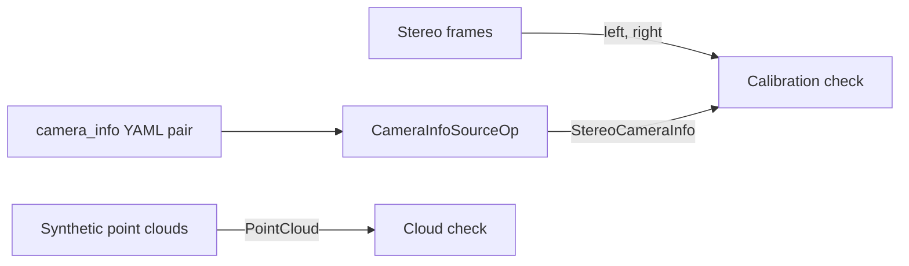

# Messages

The demo of the [holoscan-messages](../../modules/messages/) module. It writes a stereo calibration
with known values as the two ROS `camera_info` YAML files that a ROS stereo calibration writes,
sends it with `CameraInfoSourceOp` to an operator that takes stereo frames and the camera info with
the module's recommended contract, and checks every field and the extrinsics recovered from the
files. Alongside, synthetic point clouds with points, colors and normals go through the graph in
device or host memory, and every value is checked. It uses the installed module the way any other
project would: `find_package(holoscan-messages)`.



The frames are bare SDK headers with capture times: the calibration check aligns them and takes
the camera info the way an image operator would, without needing pixels. The whole graph runs on one
worker, as the module's README advises for a graph with
[more than one source](../../modules/messages/README.md#run-a-graph-on-one-worker).

## Requirements

- holoscan-messages 1.0 or later, installed (see [its README](../../modules/messages/README.md)),
  and what it needs: Holoscan SDK 5.0 (Core), CUDA 13, CMake 4.0 or later and a C++20 compiler.

The demo downloads nothing and needs no models or data: it writes its calibration files to a
temporary folder and removes them when it ends.

## Build and run

From the repository root, after installing the module into `install/`:

```bash
cmake -S applications/messages -B build/messages_demo -G Ninja \
  -DCMAKE_BUILD_TYPE=Release -DCMAKE_PREFIX_PATH="$PWD/install"
cmake --build build/messages_demo
build/messages_demo/messages_demo --count 300                                    # synthetic mode
build/messages_demo/messages_demo --count 60 --period-ms 5 --info-period-ms 20   # ci mode
```

| Mode | Behavior |
| --- | --- |
| `synthetic` (default) | 300 stereo frames every 10 ms with camera info every 100 ms, and 300 point clouds in device memory. |
| `ci` | 60 frames and clouds every 5 ms, camera info every 20 ms; a finite headless check that CI runs. |

| Option | Default | |
| --- | --- | --- |
| `--count N` | 300 | Stereo frames and point clouds |
| `--period-ms N` | 10 | Their period, 1..1000 ms |
| `--info-period-ms N` | 100 | `CameraInfoSourceOp`'s period, 1..10000 ms |
| `--cloud-memory WHERE` | `device` | `device` or `host` |
| `--compile-only BOOL` | `false` | Build and check the graph, print how many workers it runs on, and exit |

What it checks:

- The calibration: a raw pair with plumb_bob distortion, slightly different intrinsics, the right
  camera 12 cm to the right and turned by about a degree, and the rectifications of the pair. Every
  camera field read from the files equals the one written, and the extrinsics recovered from R and P
  are within 1e-9 of the true ones (the output's `extrinsics_error`).
- The contract: every frame is processed, and every frame from the first camera info on has it
  (`CameraInfoSourceOp` sends its first when the run starts).
- The clouds: organized 48x64 clouds of a tilted plane, with invalid points and unknown normals, an
  absent intensity, and `valid_count`; every value, bit for bit, in each cloud.

The exit status is 0 only when all of it matched:

```text
messages: frames=60/60 with_camera_info=60 wrong_camera_info=0 extrinsics_error=2.55e-16 clouds=60/60 wrong_clouds=0
messages: verdict=PASS
```

## Tests

With `-DBUILD_TESTING=ON`, `ctest` runs the demo with clouds in device and in host memory, with
camera info much slower than the frames, and with invalid options, checking its exit status and
output, and checks that the graph compiles to one worker.
