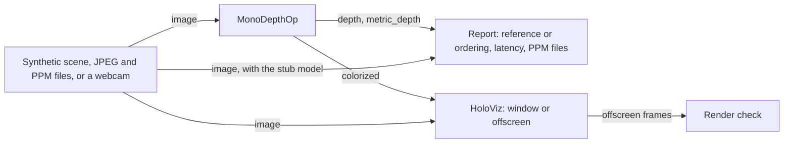

# Mono Depth

The demo of the [holoscan-mono-depth](../../modules/mono-depth/) module. A source (a synthetic
scene with known depth, JPEG and PPM files, or a live V4L2 webcam) feeds `MonoDepthOp`, whose
depth a reporter checks, times and can write, colorized, as PPM files. HoloViz shows each image
beside its colorized depth, in a window or rendered offscreen into GPU memory, where the rendering
is checked. It uses the installed module the way any other project would:
`find_package(holoscan-mono-depth)`.

> **The depth is relative.** Depth Anything V2 Small gives relative inverse depth: nearer is
> larger, in units that change from image to image. The demo checks that it ranks the synthetic
> scene as its true depth does; it does not, and cannot, check meters. See the module's
> [Metric depth](../../modules/mono-depth/README.md#metric-depth).



## Requirements

- holoscan-mono-depth, installed (see [its README](../../modules/mono-depth/README.md)), and what
  it needs: Holoscan SDK 5.0 with Core, Sensor I/O, Inference and Visualization, CUDA 13 with
  nvJPEG, CMake 4.0 or later and a C++20 compiler.
- For the `camera` mode: a V4L2 webcam offering YUYV, and a display. It runs only locally.
- For the real model only: the model prepared as below.

## Prepare the model

The `demo`, `files` and `camera` modes and the real-model tests need Depth Anything V2 Small
exported to ONNX at 518x518. The module's
[`prepare_model.py`](../../modules/mono-depth/tools/prepare_model.py) downloads the pinned
checkpoint (Apache-2.0), checks it, and exports it with PyTorch and Transformers, which you install
in a virtual environment of their own. From the repository root:

```bash
python3 -m venv ~/depth-export-venv
~/depth-export-venv/bin/pip install --index-url https://download.pytorch.org/whl/cpu torch
~/depth-export-venv/bin/pip install transformers safetensors
python3 modules/mono-depth/tools/prepare_model.py --output data/mono_depth \
  --python ~/depth-export-venv/bin/python
```

This writes `data/mono_depth/depth_anything_v2_small_518x518.onnx`, where the modes and the tests
look for it. Copy your own JPEG or PPM images into `data/mono_depth/images` for the `files` mode.

## Build and run

From the repository root, after installing the module into `install/`:

```bash
cmake -S applications/mono_depth -B build/mono_depth -G Ninja \
  -DCMAKE_BUILD_TYPE=Release -DCMAKE_PREFIX_PATH="$PWD/install"
cmake --build build/mono_depth
```

The modes in [metadata.json](metadata.json) are these commands, where `<holohub_data_dir>` is the
repository's `data` folder:

| Mode | Behavior |
| --- | --- |
| `demo` (default) | 300 frames of the synthetic scene through Depth Anything V2 Small, each checked against the scene's true depth, with the latency and the GPU memory. |
| `files` | Each image in `data/mono_depth/images` once, printing its depth range and writing its colorized depth to the build folder. |
| `camera` | A live webcam beside its depth in a HoloViz window. Local only. |
| `ci` | 30 synthetic BGR8 frames through TensorRT with the stub model, every depth value checked against the host reference of the whole pipeline. Needs no download; CI runs it. |

```bash
build/mono_depth/mono_depth --model data/mono_depth/depth_anything_v2_small_518x518.onnx \
  --count 300 --period-ms 10                                            # demo mode
build/mono_depth/mono_depth --model data/mono_depth/depth_anything_v2_small_518x518.onnx \
  --display window --count 300                                          # and show it
build/mono_depth/mono_depth --model stub --count 30 --period-ms 5 --encoding bgr8   # ci mode
```

The `demo` mode prints, on an RTX 5090:

```text
mono_depth: frames=300/300 latency_ms: mean=1.432 p50=1.392 p99=2.478 max=3.624 gpu_memory_mib=338 inverse_depth=0.229..4.754 ordering: checked=300 failed=0 spearman_min=0.9185 spearman_mean=0.9194
mono_depth: verdict=PASS
```

The latency is the time from a frame's capture (once the synthetic scene is drawn on the CPU) to
its depth on the host. `gpu_memory_mib` is how much the GPU's free memory dropped during the run,
so other processes on the GPU move it. The first run builds the TensorRT engine from the ONNX file
and caches it beside the file; later runs start in seconds.

The synthetic scene is ray-cast on the CPU: a checkered floor receding to a far wall, a blue panel
standing near the camera and an orange sphere rolling between them, with their true depth. With a
real model, each frame is checked against it: Spearman's rank correlation of the predicted inverse
depth with the true one must be at least `--min-spearman` (0.85), and the panel must be predicted
nearer than the sphere and the sphere nearer than the wall.

`--model stub` writes and uses the module's stand-in model, whose output is a fixed weighted sum of
each pixel's normalized color. It is written to the working directory, where its engines are cached
too. With it, the reporter takes the very image the estimator saw and checks every depth value, and
every metric value, against the host reference of the whole pipeline (exact with `--fp16 false`).

Each run prints the frame count, the latency, the GPU memory, the inverse depth's range (and the
meters', with metric depth) and, as they apply, the checks. A gap in the frame ids fails the run
(but in real time, see below). Then comes a `verdict`: `PASS`, `FAIL`, or `STOPPED` when an
interrupt or a closed window ends the run early. It exits 0 on `PASS`, or on `STOPPED` for a camera
run without `--count`; 2 for invalid options, a missing camera among them; else 1.

### The display

`--display window` opens a HoloViz window, twice the frame's width: the image on the left, its
colorized depth on the right, far dark blue to near dark red. It is the default for the camera when
a display is available. `--display offscreen` renders the same frames into GPU memory instead (a
HoloViz `CudaSinkDesc`), with no display needed; `--render-file FILE` writes the newest one as a
PPM. With the stub model and `--still true` (the scene's first frame throughout), the rendered
frames are known exactly, and each is checked: at most 1 % of pixels may be off by more than 8 in
a channel. The display is real time in either mode: HoloViz keeps only the newest depth and never
holds the estimator back.

### Lossless or real time

Synthetic frames and files are lossless: every frame's depth is estimated and reported in order,
and the source sends a frame only when the reporter is done with the one before. The camera, and
synthetic frames with `--realtime true`, are real time: every edge keeps only the newest sample, so
a slow reporter skips frames (counted as `skipped`) rather than holding the estimator back, and the
run ends at the last frame's id. `--report-delay-ms` slows the reporter down, to show it.

### Options

`mono_depth --help` lists them all. Beyond the above: `--input-width`, `--input-height` and
`--resize letterbox|stretch` for the model's input; `--fp16 false` for an FP32 engine;
`--model-output metric` for a metric checkpoint, or `--metric-scale` and `--metric-shift` for meters
from the relative model; `--color-min` and `--color-max` for a fixed color range; `--encoding`,
`--width`, `--height` and `--host-input` for synthetic frames; `--loop` and `--count` for files;
`--device` for the camera; `--image-dir DIR` to write each frame's colorized depth as
`DIR/depth_NNNNNN.ppm`.

## Tests

`cmake -DBUILD_TESTING=ON` builds them; `ctest --test-dir build/mono_depth` runs them. All but the
host test need a GPU; none needs a download.

- With the stub model, every depth value checked against the reference: every encoding, GPU and
  host memory, wide, tall, small and large frames, a stretched wide input, FP16 and FP32, metric
  depth from an affine and from a metric model, colorized files, image files (baseline and
  progressive JPEG, PPM, RGB8 and BGR8, looped), and the real-time path with a slow reporter.
- The offscreen rendering, checked frame by frame.
- Invalid options, a model that is not one, a stop request, and a run without managed signal
  handling.
- With the real model, skipped unless it is in `MONO_DEPTH_DATA_DIR` (`data/mono_depth`): the
  synthetic scene's ordering, letterboxed, stretched and rendered offscreen.
- `tests/host/`: the webcam's YUYV conversion, which the hosted CI job also runs.
