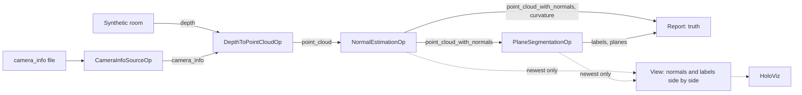

# Normals and Planes

The demo of the [holoscan-normals](../../modules/normals/) module. A synthetic depth camera looks
into a room with a floor, two walls, a table with a box on it, a box on the floor and a moving
sphere, with depth noise and missing pixels; holoscan-point-cloud's `DepthToPointCloudOp`
deprojects each frame into a `PointCloud` message, with the camera from a ROS `camera_info` file
through `CameraInfoSourceOp` from [holoscan-messages](../../modules/messages/); `NormalEstimationOp`
adds every point's normal to the cloud and gives its curvature, and `PlaneSegmentationOp` finds the
planes and labels every pixel with its plane. A reporter checks every frame against the room's
truth, and HoloViz shows the normals color-mapped beside the plane labels. It uses the installed
modules the way any other project would: `find_package(holoscan-messages)`,
`find_package(holoscan-point-cloud)` and `find_package(holoscan-normals)`.



## Demo

Videos of the demo go in [tests/video](tests/video).

## Requirements

- holoscan-messages 1.0, holoscan-point-cloud 2.0 and holoscan-normals 1.0, installed (see their
  READMEs), and what they need: Holoscan SDK 5.0 with Core and Sensor I/O (Visualization for the
  display), CUDA 13, CMake 4.0 or later and a C++20 compiler.

The demo downloads nothing and needs no models or data: it renders its frames, and writes the
synthetic camera's `camera_info` file to a folder of its own in the temporary folder, removing it
when the run ends.

## Build and run

From the repository root, after installing the modules into `install/`:

```bash
cmake -S applications/normals_planes -B build/normals_planes -G Ninja \
  -DCMAKE_BUILD_TYPE=Release -DCMAKE_PREFIX_PATH="$PWD/install"
cmake --build build/normals_planes
build/normals_planes/normals_planes --count 300                                # synthetic mode
build/normals_planes/normals_planes --count 30 --period-ms 10 --display false  # ci mode
```

The modes in [metadata.json](metadata.json) are these commands:

| Mode | Behavior |
| --- | --- |
| `synthetic` (default) | 300 frames of the synthetic room, each checked against its truth, shown in HoloViz when a display is available. |
| `ci` | 30 frames at 640x480 without a display, each checked against its truth; a finite headless check that CI runs. |

| Option | Default | |
| --- | --- | --- |
| `--count N` | `300` | Frames |
| `--period-ms N` | `33` | Camera period, 1..1000 ms |
| `--width N --height N` | `640 480` | Image size, 64x48 to 4096x4096 |
| `--search window\|knn\|radius` | `window` | The normals' neighborhood: the image window, the 24 nearest within 10 cm, or every point within 4 cm |
| `--window-radius N` | `3` | The window is `(2N + 1)^2` pixels, 1..15; use 6 at 1280x720 |
| `--merge true\|false` | `false` | Merge coplanar planes |
| `--display auto\|true\|false\|offscreen` | `auto` | Show the normals and planes in HoloViz; `auto` when `DISPLAY` or Wayland is set; `offscreen` renders into CUDA memory and checks what was rendered |
| `--max-points N` | the image's size | The largest cloud the operators take, which sizes their outputs; a larger cloud fails the run |
| `--timeout-seconds N` | `120` | Allowance beyond the expected run time, which is 2 x count x period |
| `--compile-only true\|false` | `false` | Build and check the graph without running it; prints its worker count |

| CMake option | Default | |
| --- | --- | --- |
| `NORMALS_PLANES_ENABLE_VISUALIZATION` | `ON` | Build the HoloViz display |
| `BUILD_TESTING` | `OFF` | Build the demo's tests |

The window shows the frame twice side by side: on the left each normal as a color (its x, y, z in the
camera frame mapped to red, green, blue: the floor purple, the back wall green, the side wall pink), on the right
each plane in a color of its own, points on no plane dark gray, points without a normal black.

The whole graph runs on one worker (`graph.partition("normals_planes").include_all()`), the
display included: with the camera info it has two sources, and the automatic partitioning would
give its parts workers of their own, where an operator in the middle could find a lossless queue
full, which fails the run. The source keeps at most two frames in flight, and sends a frame again
when the deprojection cannot take it yet. The display branch keeps only the newest frame
(`QueuePolicy::kDropOldest`, depth 1), so it never holds the pipeline back.

## What it checks

For each frame the reporter compares:

- the normals with the room's analytic normals: at least 90 % of the room's points with a normal,
  and on the inside of every surface (where the window sees only that surface) a median angle error
  of at most 1.5 degrees and a 95th percentile of at most 5 (3 and 9 with `--search knn`), and none
  facing away;
- the curvature: the sphere's median above the flat surfaces';
- the floor, the back wall, the side wall and the table top with the planes found: within 1 degree
  and 15 mm, the plane's centroid within 15 mm of the true plane, over 90 % of each surface's points
  labeled with its plane, and over 96 % of that plane's labels on the surface; and every plane's
  inlier count equal to the points with its label.

## Output

Each run prints the frames checked, the frames that came before the first camera info (which give
no cloud; at most the first may, as the source waits a period before it), the results above and,
with `--display offscreen`, the frames HoloViz rendered. Every frame after the first camera info
must be checked; a gap in the frame ids fails the run and is printed too. Then comes a `verdict`:
`PASS`, `FAIL`, or `STOPPED` when an interrupt ends the run early. It exits 0 on `PASS`, 2 for
invalid options, else 1:

```text
normals_planes: frames=30/30 before_camera_info=0 normals: share=1.000 worst_median_deg=1.099 worst_p95_deg=3.386 flipped=0 planes_per_frame=8.000 planes: worst_angle_deg=0.016 worst_offset_mm=0.350 worst_centroid_mm=0.033 wrong_inliers=0 worst_recall=0.992 worst_precision=0.970 wrong_planes=0 flat_sphere=0
normals_planes: verdict=PASS
```

## Tests

With `-DBUILD_TESTING=ON`, `ctest --test-dir build/normals_planes` runs the demo with each search,
with a wider window and merging, and at 1280x720, all checked against the truth; renders both views
offscreen in HoloViz and checks the frames; compiles the graph with and without the display and
checks that it runs on one worker; checks the exit status and verdict of failed, timed-out, stopped
and invalid runs, and of a run without managed signal handling. No test needs data.

## Licenses

Apache-2.0, like the modules it uses. See their NOTICE files.
