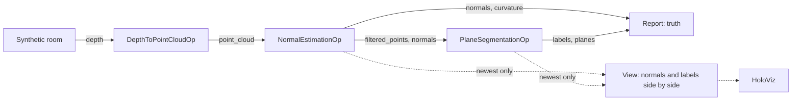

# Normals and Planes

The demo of the [holoscan-normals](../../modules/normals/) module. A synthetic depth camera looks
into a room with a floor, two walls, a table with a box on it, a box on the floor and a moving
sphere, with depth noise and missing pixels; holoscan-point-cloud's `DepthToPointCloudOp`
deprojects each frame, `NormalEstimationOp` estimates every point's normal and curvature, and
`PlaneSegmentationOp` finds the planes and labels every pixel with its plane. A reporter checks
every frame against the room's truth, and HoloViz shows the normals color-mapped beside the plane
labels. It uses the installed modules the way any other project would:
`find_package(holoscan-point-cloud)` and `find_package(holoscan-normals)`.



## Requirements

- holoscan-point-cloud and holoscan-normals, installed (see their READMEs), and what they need:
  Holoscan SDK 5.0 with Core and Sensor I/O (Visualization for the display), CUDA 13, CMake 4.0 or
  later and a C++20 compiler.

The demo downloads nothing and needs no models or data: it renders its frames.

## Build and run

From the repository root, after installing both modules into `install/`:

```bash
cmake -S applications/normals_planes -B build/normals_planes -G Ninja \
  -DCMAKE_BUILD_TYPE=Release -DCMAKE_PREFIX_PATH="$PWD/install"
cmake --build build/normals_planes
build/normals_planes/normals_planes --count 300                                # synthetic mode
build/normals_planes/normals_planes --count 30 --period-ms 10 --display false  # ci mode
```

| Option | Default | |
| --- | --- | --- |
| `--count N` | `300` | Frames |
| `--period-ms N` | `33` | Camera period, 1..1000 ms |
| `--width N --height N` | `640 480` | Image size, 64x48 to 4096x4096 |
| `--search window\|knn\|radius` | `window` | The normals' neighborhood: the image window, the 24 nearest within 10 cm, or every point within 4 cm |
| `--window-radius N` | `3` | The window is `(2N + 1)^2` pixels, 1..15; use 6 at 1280x720 |
| `--merge true\|false` | `false` | Merge coplanar planes |
| `--display auto\|true\|false\|offscreen` | `auto` | Show the normals and planes in HoloViz; `auto` when `DISPLAY` or Wayland is set; `offscreen` renders into CUDA memory and checks what was rendered |
| `--timeout-seconds N` | `120` | Allowance beyond the expected run time |
| `--compile-only true\|false` | `false` | Build and check the graph without running it |

| CMake option | Default | |
| --- | --- | --- |
| `NORMALS_PLANES_ENABLE_VISUALIZATION` | `ON` | Build the HoloViz display |
| `BUILD_TESTING` | `OFF` | Build the demo's tests |

The window shows the frame twice side by side: on the left each normal as a color (its x, y, z in the
camera frame mapped to red, green, blue: the floor purple, the back wall green, the side wall pink), on the right
each plane in a color of its own, points on no plane dark gray, points without a normal black.

The operators cannot send a refused output again, so the source keeps one frame in flight: it
renders the next frame only once the reporter has counted the previous one, and no lossless queue
ever fills. The display branch keeps only the newest frame (`QueuePolicy::kDropOldest`, depth 1),
so it never holds the pipeline back.

## What it checks

For each frame the reporter compares:

- the normals with the room's analytic normals, on the inside of every surface (where the window
  sees only that surface): median angle error at most 1.5 degrees and 95th percentile at most 5
  (3 and 9 with `--search knn`), and none facing away;
- the curvature: the sphere's median above the flat surfaces';
- the floor, the back wall, the side wall and the table top with the planes found: within 1 degree
  and 15 mm, over 90 % of each surface's points labeled with its plane, and over 96 % of that
  plane's labels on the surface.

It prints, for example (x86_64, 30 frames):

```text
normals_planes: frames=30/30 normals: worst_median_deg=1.099 worst_p95_deg=3.386 flipped=0 planes_per_frame=8.000 planes: worst_angle_deg=0.016 worst_offset_mm=0.350 worst_recall=0.992 worst_precision=0.970 wrong_planes=0 flat_sphere=0
normals_planes: verdict=PASS
```

The `ci` mode passes only when every frame passes. A stop request (Ctrl+C) ends the run with
`verdict=STOPPED`.

## Tests

With `-DBUILD_TESTING=ON`, `ctest --test-dir build/normals_planes` runs the demo with each search,
with a wider window and merging, and at 1280x720, all checked against the truth; renders both views
offscreen in HoloViz and checks the frames; compiles the window display graph without a display;
and checks that unusable arguments are usage errors.

## Licenses

Apache-2.0, like the modules it uses. See their NOTICE files.
