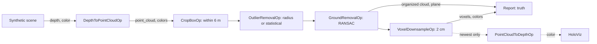

# PCL Filters

The demo of the [holoscan-pcl-filters](../../modules/pcl-filters/) module. A synthetic depth camera
looks down at flat ground with three boxes and a moving sphere, with depth noise, flying pixels and
missing depth; holoscan-point-cloud's `DepthToPointCloudOp` deprojects each frame, and the four
filters clean it up on the GPU. A reporter checks every frame against the scene's truth, and with a
display, `PointCloudToDepthOp` projects the voxels back into the camera for HoloViz. It uses the
installed modules the way any other project would: `find_package(holoscan-point-cloud)` and
`find_package(holoscan-pcl-filters)`.



Every filter keeps the cloud organized (`OutputLayout::kKeep`) up to the voxel grid, so the
reporter can tell, pixel by pixel, what is left of the ground, the objects and the flying pixels.

## Requirements

- holoscan-point-cloud and holoscan-pcl-filters, installed (see their READMEs), and what they need:
  Holoscan SDK 5.0 with Core and Sensor I/O (Visualization for the display), CUDA 13, CMake 4.0 or
  later and a C++20 compiler.

The demo downloads nothing and needs no models or data: it renders its frames.

## Build and run

From the repository root, after installing both modules into `install/`:

```bash
cmake -S applications/pcl_filters -B build/pcl_filters -G Ninja \
  -DCMAKE_BUILD_TYPE=Release -DCMAKE_PREFIX_PATH="$PWD/install"
cmake --build build/pcl_filters
build/pcl_filters/pcl_filters --count 300                                # synthetic mode
build/pcl_filters/pcl_filters --count 30 --period-ms 10 --display false  # ci mode
```

| Option | Default | |
| --- | --- | --- |
| `--count N` | `300` | Frames |
| `--period-ms N` | `33` | Camera period, 1..1000 ms |
| `--width N --height N` | `640 480` | Image size, 64x48 to 4096x4096 |
| `--voxel-size M` | `0.02` | Voxel side in meters |
| `--outliers radius\|statistical` | `radius` | Outlier removal: 3 cm and 3 neighbors, or k 8 within 10 cm and 2 deviations |
| `--display auto\|true\|false` | `auto` | Show the voxels in HoloViz; `auto` when `DISPLAY` or Wayland is set |
| `--timeout-seconds N` | `120` | Allowance beyond the expected run time |
| `--compile-only true\|false` | `false` | Build and check the graph without running it |

| CMake option | Default | |
| --- | --- | --- |
| `PCL_FILTERS_ENABLE_VISUALIZATION` | `ON` | Build the HoloViz display |
| `BUILD_TESTING` | `OFF` | Build the demo's tests |

The filters cannot send a refused output again, so the source keeps one frame in flight: it renders
the next frame only once the reporter has counted the previous one, and no lossless queue ever
fills. The display branch keeps only the newest voxels (`QueuePolicy::kDropOldest`, depth 1), so it
never holds the filters back.

## What it checks

For each frame the reporter compares:

- the ground plane with the true ground: within 1 degree and 2 cm;
- the organized cloud after ground removal with each pixel's label: under 1 % of the ground and
  under 10 % of the flying pixels left, over 85 % of the object points kept;
- the number of voxels with a CPU count of the voxels of that same cloud: exactly equal, every voxel
  with a color.

It prints, for example (x86_64, 30 frames):

```text
pcl_filters: frames=30/30 ground_left=0.00% objects_kept=97.58% outliers_left=0.57% voxels_per_frame=9164 wrong_voxel_counts=0 plane: max_angle_deg=0.0036 max_offset_m=0.0004 wrong_planes=0
pcl_filters: verdict=PASS
```

The `ci` mode passes only when every frame passes. A stop request (Ctrl+C) ends the run with
`verdict=STOPPED`.

## Tests

With `-DBUILD_TESTING=ON`, `ctest --test-dir build/pcl_filters` runs the demo with each outlier mode
and at 1280x720, all checked against the truth; compiles the display graph without a display; and
checks that unusable arguments are usage errors.

## Licenses

Apache-2.0, like the modules it uses. See their NOTICE files.
