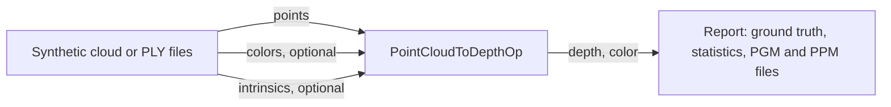

# Point Cloud to Depth

The demo of `PointCloudToDepthOp` from the [holoscan-point-cloud](../../modules/point-cloud/)
module. A source, either a synthetic cloud with known ground truth or a folder of PLY files, feeds
the operator, and a reporter checks every depth and color pixel of the images against the truth,
measures them and can write them as PGM and PPM files. It uses the installed module the way any
other project would: `find_package(holoscan-point-cloud)`.



## Demo

Videos of the demo on synthetic input and on real input go in [tests/video](tests/video).

## Requirements

- holoscan-point-cloud 1.1 or later, installed (see [its README](../../modules/point-cloud/README.md)),
  and what it needs: Holoscan SDK 5.0 with Core and Sensor I/O (Testing for the tests), CUDA 13,
  CMake 4.0 or later and a C++20 compiler.

The demo downloads nothing and needs no models. The `files` mode reads your own point clouds; every
other mode makes its clouds.

## Build and run

From the repository root, after installing the module into `install/`:

```bash
cmake -S applications/point_cloud_to_depth -B build/point_cloud_to_depth -G Ninja \
  -DCMAKE_BUILD_TYPE=Release -DCMAKE_PREFIX_PATH="$PWD/install"
cmake --build build/point_cloud_to_depth
build/point_cloud_to_depth/point_cloud_to_depth --count 300   # synthetic mode
build/point_cloud_to_depth/point_cloud_to_depth --count 30 --period-ms 5 \
  --depth-format uint16 --intrinsics-input true                # ci mode
```

The modes in [metadata.json](metadata.json) are these commands and the `files` mode below:

| Mode | Behavior |
| --- | --- |
| `synthetic` (default) | 300 synthetic clouds with colors, every depth and color pixel checked against ground truth. |
| `files` | Projects the PLY files in the data directory, `<holohub_data_dir>/point_cloud_to_depth`. |
| `ci` | 30 synthetic clouds with colors and per-frame intrinsics into uint16 depth, checked against ground truth; a finite headless check that CI runs. |

The synthetic clouds come from the module's synthetic depth camera: a tilted plane with a dome,
small holes with no depth, and a patch 50 m away, beyond the default range of 0.1 to 10 m, all
moving from frame to frame. Each frame's depth image is deprojected on the GPU, moved into a body
frame (x forward, y left, z up, the camera 12 cm forward, 4 cm right and 35 cm up), and shuffled into
an unorganized cloud; the operator is given the inverse transform. Points that must not reach the
image are mixed in: for every tenth pixel a duplicate twice as far along its ray, for every fiftieth
a point behind the camera and another outside the field of view, and a non-finite point for every
pixel without depth. The ground truth is the camera's depth image itself: each pixel must hold the
nearest valid depth among the pixels its square covers (within 1 µm plus 1 µm per meter, exactly for
uint16 millimeters), the color of a point at that depth, or nothing where no valid depth is.

`--depth-format uint16` makes uint16 millimeters instead of float32 meters, `--point-size 3` or `5`
draws each point as a square, `--host-input true` sends the clouds from host instead of GPU memory,
and `--intrinsics-input true` sends per-frame intrinsics. `--image-dir DIR` writes each depth image
as `DIR/depth_NNNNNN.pgm`, 16-bit millimeters, and each color image as `DIR/color_NNNNNN.ppm`. The
PGM rounds each depth to the nearest millimeter: below 0.5 mm it shows as 0, and beyond 65.535 m as
65535. `--help` lists every option.

A run fails as timed out when no image arrives for `--timeout-seconds` (default 120) plus two source
periods. Checking an image against the truth takes the host about 12 ms at 1280x720, and seconds at
4096x4096 with 5x5 splats; for large images, add `--verify false` or raise `--timeout-seconds`.

### Your own point clouds

The file source reads binary little-endian PLY files whose only element is `vertex`, with the
properties `float x`, `float y`, `float z`, optionally followed by `uchar red`, `uchar green`,
`uchar blue`. Either every file has colors or none does. ASCII and big-endian files, other
properties and other elements are rejected with an error naming the file and what it does not
support.

Give the image size and the camera's intrinsics, and the extrinsics if the points are not in the
camera optical frame, as twelve comma-separated numbers, `R` and `t` row by row. `R` must be a
rotation, without scale or mirroring:

```bash
build/point_cloud_to_depth/point_cloud_to_depth --source files --clouds path/to/ply/folder \
  --width 640 --height 480 --fx 615 --fy 615 --cx 319.5 --cy 239.5 --image-dir .
```

## Output

Each run prints the frame and pixel counts, the filled pixels and their depth range and, for
synthetic input, how many depths and colors differ from the truth and the largest error. A gap in
the frame ids fails the run and is printed too. So does a run whose images, unchecked against a
truth, are all empty, which most likely means wrong intrinsics or extrinsics. Then comes a
`verdict`: `PASS`, `FAIL`, or `STOPPED` when an interrupt ends the run early. It exits 0 on `PASS`,
2 for invalid options, else 1:

```text
point_cloud_to_depth: frames=30/30 pixels=9216000 filled=8878080 depth_m=[1.040, 2.196] truth: wrong_depths=0 wrong_colors=0 max_error_m=0.00e+00
point_cloud_to_depth: verdict=PASS
```

## Performance

On an RTX 5090 (driver 595.91.07) with SDK 5.0.0 and CUDA 13.2, projecting a synthetic cloud of
1,050,624 points with colors into a 1280x720 image takes a median of 24.4 µs on the GPU: 2.5 µs to
clear the z-buffer, 11.4 µs to project and 10.5 µs to resolve depth and color; uint16 depth takes
24.5 µs. With 5x5 splats the projection takes 258.6 µs, as each point writes 25 pixels. Measured
with Nsight Systems 2026.4.1 over 200 frames, from the kernel and memory operation summaries
(`nsys stats --report cuda_gpu_kern_sum` and `--report cuda_gpu_mem_time_sum`) of:

```bash
nsys profile -t cuda --sample=none --cpuctxsw=none -o pcd \
  build/point_cloud_to_depth/point_cloud_to_depth --width 1280 --height 720 --count 200
nsys profile -t cuda --sample=none --cpuctxsw=none -o pcd_u16 \
  build/point_cloud_to_depth/point_cloud_to_depth --width 1280 --height 720 --count 200 --depth-format uint16
nsys profile -t cuda --sample=none --cpuctxsw=none -o pcd_p5 \
  build/point_cloud_to_depth/point_cloud_to_depth --width 1280 --height 720 --count 200 --point-size 5
```

The synthetic source's own kernel, which makes each cloud, takes about 89 µs of the same frames and
is not part of the operator.

## Tests

With `-DBUILD_TESTING=ON`, `ctest` checks the demo's operators, the file source with a consumer far
slower than its clock and the reporter's frame-id check, completion and truth settings, and the
demo's runs: synthetic clouds in every variant (float32 and uint16, host and GPU memory, configured
and per-frame intrinsics, every splat size, narrower and wider ranges) against ground truth; folders
of PLY files with and without colors, once and looped; image output; and the exit status and verdict
of failed, empty, slow, timed-out, stopped and invalid runs, and of a run without managed signal
handling. The PLY, PGM and PPM file test in [tests/host/](tests/host/) needs neither the SDK nor a
GPU, and also runs on the hosted CI job. None of it needs data.

## Licenses

Apache-2.0. The module's README lists the licenses of what it uses.
