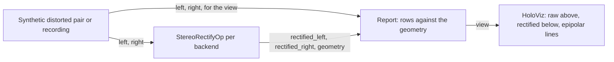

# Rectify

The demo of the [holoscan-rectify](../../modules/rectify/) module. A stereo source, either a
synthetic distorted pair with known geometry or a recording, feeds a `StereoRectifyOp` for each
backend asked for, and a reporter checks each rectified pair: on the synthetic pair, that every dot
lies on the same row in both images, where the geometry puts it; on a recording, which the camera
has rectified already, that nothing changes. The first backend's raw and rectified pairs can be
shown on a HoloViz display, with epipolar lines. It uses the installed module the way any other
project would: `find_package(holoscan-rectify)`.



## Requirements

- holoscan-rectify, installed (see [its README](../../modules/rectify/README.md)), and what it
  needs: Holoscan SDK 5.0 with Core and Sensor I/O (Visualization for the display, Testing for the
  tests), CUDA 13, CMake 4.0 or later and a C++20 compiler.

The demo downloads nothing. The recording mode reads a recording of holoscan-stereo-camera's format
(`calibration.json`, `index.csv`, 8-bit PGM eyes); a small reader in [src/](src/) reads it.

## Build and run

From the repository root, after installing the module into `install/`:

```bash
cmake -S applications/rectify -B build/rectify_demo -G Ninja -DCMAKE_BUILD_TYPE=Release \
  -DCMAKE_PREFIX_PATH="$PWD/install"
cmake --build build/rectify_demo
build/rectify_demo/rectify --backend all,auto --count 300            # synthetic mode
build/rectify_demo/rectify --backend all,auto --count 30 --period-ms 10 --display false   # ci mode
build/rectify_demo/rectify --recording "$HOLOSCAN_TEST_DATA/stereo-camera/d585_720p_emitter_on"
```

| Option | Default | |
| --- | --- | --- |
| `--distortion` | `brown_conrady` | The synthetic pair's lenses: `brown_conrady`, `rational_polynomial` or `kannala_brandt4` (a wide fisheye) |
| `--width`, `--height` | 1280, 720 | The synthetic images' size |
| `--recording DIR` | | Rectify a recording instead |
| `--count N` | 300 (a recording's frames) | Pairs to send; a recording repeats when shorter |
| `--period-ms N` | 33 | Time between pairs |
| `--device-input` | `false` | Send the pairs in GPU memory |
| `--backend LIST` | `auto` | `cuda`, `vpi-cuda`, `vpi-vic`, `vpi-pva`, `auto`, or `all` that this machine can run |
| `--interpolation` | `linear` | `linear` or `nearest` |
| `--alpha X` | 0 | 0 keeps only valid pixels, 1 every pixel |
| `--display` | `auto` | Show the first backend's pairs (`auto`: when a display is available) |
| `--compile-only` | `false` | Build and compile the graph, then exit |

The synthetic pair is two 1280x720 cameras with strong barrel distortion and tangential terms (or a
fisheye), the right one 12 cm away, not quite horizontally, and turned by about a degree on each
axis, looking at a plane of Gaussian dots over a faint checkerboard 2 m away. Each raw image is
rendered exactly, by undistorting every pixel and meeting its ray with the plane, so the dots of a
correctly rectified pair are Gaussians centered where the geometry projects them. The dots move
from pair to pair.

The display shows the raw pair above the rectified one, with green lines every 40 rows across both:
on the raw pair the dots and the checkerboard bend and wander off the lines, on the rectified pair
each dot sits on the same line in both images. The yellow rectangles are the rectified images'
valid regions.

## Output

```text
rectify: geometry 1280x720 fx=781.118 cx_left=602.018 cx_right=602.018 cy=359.061 baseline_m=0.120069 doffs=0 valid_left=0,0,1280x720
rectify: backend=cuda frames=30/30 geometry=ok dots=8244 missing=0 row_error_px(max/rms)=0.048/0.009 position_error_px(max)=0.046
rectify: backend=vpi-cuda frames=30/30 geometry=ok dots=8244 missing=0 row_error_px(max/rms)=0.047/0.009 position_error_px(max)=0.046
rectify: backend=auto:cuda frames=30/30 geometry=ok dots=8244 missing=0 row_error_px(max/rms)=0.048/0.009 position_error_px(max)=0.046
rectify: auto=cuda expected=cuda (x86_64)
rectify: verdict=PASS
```

A run passes when every pair came through, every geometry message matches the rectification, and
on the synthetic pair no dot is missing, every row error is under 0.1 px and every position error
under 0.15 px; on a recording, no pixel changed by more than one gray level. On a CI runner
(`HOLOSCAN_CI_PLATFORM`), auto must also have picked `vpi-vic` on a Jetson and `cuda` on x86_64.
The exit status is 0 for a pass, 1 for a failure or a stop request, and 2 for bad options.

The source sends a pair only when every reporter has finished the one before, so the lossless edges
never refuse a pair; the display's edge keeps only the newest view. Only the reporter that draws the
view takes the raw pairs (on a recording, the reporters read its files again): the SDK releases a
buffer to at most eight consumers' streams, and `--backend all,auto` makes five rectifiers on a
Jetson.

## Tests

`ctest` in the build folder runs the demo on the synthetic pair through every backend and auto,
from host and GPU memory and with a fisheye; its refusals of bad options; a stop request; a run
without managed signal handling; the display's graph; and, when `$HOLOSCAN_TEST_DATA` is set, a
recording. `tests/host/` tests the recording reader without the SDK.

## Licenses

Apache-2.0, as the repository. See the module's [NOTICE](../../modules/rectify/NOTICE).
