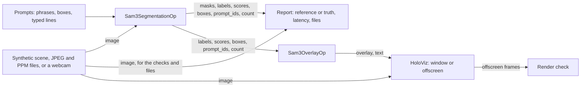

# SAM 3 Segmentation

The demo of the [holoscan-sam3](../../modules/sam3/) module. A source (a synthetic scene with known
shapes, JPEG and PPM files, or a live V4L2 webcam) feeds `Sam3SegmentationOp` with a list of
prompts, whose instances a reporter checks, times, prints and can write over their images as PPM
files. HoloViz shows each image under its instances (`Sam3OverlayOp`), in a window or rendered
offscreen into GPU memory, where the rendering is checked. New prompts can be typed while it runs.
It uses the installed module the way any other project would: `find_package(holoscan-sam3)`.

> **SAM 3 is licensed separately and gated.** Its weights are Meta's, under the SAM License; you
> request access on Hugging Face, accept the license there, and export the model with your own
> token. See the module's [README](../../modules/sam3/README.md) and [NOTICE](../../modules/sam3/NOTICE).



## Requirements

- holoscan-sam3, installed with its overlay (see [its README](../../modules/sam3/README.md)), and
  what it needs: Holoscan SDK 5.0 with Core, Sensor I/O, Inference and Visualization, CUDA 13 with
  nvJPEG, CMake 4.0 or later and a C++20 compiler.
- For the `camera` mode: a V4L2 webcam offering YUYV, and a display. It runs only locally.
- For SAM 3 only: the model prepared as below, and about 2 GiB of free GPU memory.

## Prepare the model

The `demo`, `files` and `camera` modes and the real-model tests need SAM 3 exported by the
module's [`prepare_model.py`](../../modules/sam3/tools/prepare_model.py), after you have requested
access to <https://huggingface.co/facebook/sam3> and accepted the SAM License there. From the
repository root, with PyTorch and Transformers in a virtual environment of their own (the module's
README has the details):

```bash
python3 -m venv ~/sam3-export-venv
~/sam3-export-venv/bin/pip install --index-url https://download.pytorch.org/whl/cpu torch torchvision
~/sam3-export-venv/bin/pip install transformers onnx onnxscript
export HF_TOKEN=hf_...   # your own token, with access to facebook/sam3
python3 modules/sam3/tools/prepare_model.py --output data/sam3 --accept-sam-license \
  --python ~/sam3-export-venv/bin/python
```

`data/` is ignored by git. The table holds the demo's phrases (circle, triangle, blue rectangle)
and a few everyday ones (person, face, hand, cup, bottle, phone, keyboard, chair, car); add yours
with `--prompts "apple,red mug" --prompts-only`.

## Build and run

Build the module and install it, then the demo against it:

```bash
cmake -S modules/sam3 -B build/sam3 -G Ninja -DCMAKE_BUILD_TYPE=Release
cmake --build build/sam3 && cmake --install build/sam3 --prefix "$PWD/install"
cmake -S applications/sam3_segmentation -B build/sam3_segmentation -G Ninja \
  -DCMAKE_BUILD_TYPE=Release -DCMAKE_PREFIX_PATH="$PWD/install" -DBUILD_TESTING=ON
cmake --build build/sam3_segmentation
```

The modes in [`metadata.json`](metadata.json), run from the build folder:

| Mode | Command | What it does |
| --- | --- | --- |
| `demo` | `./sam3_segmentation --model ../../data/sam3 --count 100 --period-ms 10` | SAM 3 on the synthetic scene with "circle", "blue rectangle" and "triangle", each prompt's best instance checked against its true shape (IoU at least 0.9), with latency and GPU memory |
| `files` | `./sam3_segmentation --model ../../data/sam3 --source files --images ../../data/sam3/images --prompts "person,cup,bottle" --image-dir .` | Each JPEG and PPM image's instances, printed, and drawn over the image as `segment_NNNNNN.ppm` |
| `camera` | `./sam3_segmentation --model ../../data/sam3 --source camera --display window --prompts "person,cup" --interactive true` | A live webcam under its instances; type new prompts, comma-separated, and Enter |
| `ci` | `./sam3_segmentation --model stub --count 30 --period-ms 5 --encoding bgr8 --box-on triangle` | The module's stub model through TensorRT, no download: two phrases and an exemplar box, every instance checked against the host reference |

Each run ends with a line such as:

```text
sam3_segmentation: frames=200/200 prompts=3 instances=600 latency_ms: mean=29.514 p50=29.291 p99=33.784 max=38.657 gpu_memory_mib=1612 truth: checked=200 failed=0 iou_min=0.9874 iou_mean=0.9944
sam3_segmentation: verdict=PASS
```

and exits 0 only on `PASS`. The latency is from an image's capture to its instances on the host;
the GPU memory is the drop in free memory during the run. A stop request (Ctrl+C, closing the
window) ends a run with `verdict=STOPPED`, which for a camera without `--count` is its normal end.

### Prompts

`--prompts` takes phrases from the prompt table, comma-separated. `--box x1,y1,x2,y2` adds an
exemplar box in fractions of the image, and `--box-on circle|rectangle|triangle` one around a shape
of the synthetic scene's first frame (which then stands still); the boxes make one more prompt, of
boxes alone, which SAM 3 answers with every instance like the boxed one. With `--interactive true`,
each line typed on the standard input replaces the phrases from the next image on; a phrase that is
not in the table is reported and the prompts stay. With the stub model, the phrases are "red" and
"blue", and "visual" for boxes.

### The display

`--display window` opens a HoloViz window showing each image with its instances over it, each in
its own color with its prompt and score; `--display offscreen` renders the same into GPU memory,
where, with the stub model and a still scene, every frame is checked against the expected one (the
labels' text aside), and `--render-file` writes the newest as a PPM. By default the camera gets a
window when there is a display, and other sources none.

### Lossless or real time

Synthetic frames and files run losslessly: every frame is segmented and reported, in order, the
source sending a frame only when the one before is done. The camera, and synthetic frames with
`--realtime true`, run in real time: every edge keeps only the newest sample, so the segmenter
takes the newest frame and never waits for a slower consumer, and frames that came while it was
busy are skipped and counted.

### Options

`--help` lists them all. The model: `--model DIR|stub`, `--fp16`, `--workspace-mib` (SAM 3's FP32
encoder needs 4096). The prompts: `--prompts`, `--box`, `--box-on`, `--score-threshold`,
`--mask-threshold`, `--max-instances`, `--interactive`. The input: `--source`, `--images`,
`--device`, `--loop`, `--count`, `--period-ms`, `--encoding`, `--width`, `--height`,
`--host-input`, `--still`, `--realtime`. The output: `--verify`, `--min-iou`, `--print`,
`--image-dir`, `--display`, `--render-file`, `--compile-only`, `--timeout-seconds`,
`--startup-timeout-seconds`.

## Tests

`ctest` in the build folder runs them; they need a GPU, and none needs a download.

| Tests | Check |
| --- | --- |
| `sam3_app_synthetic`, `_bgr8_fp32`, `_rgba8_host`, `_bgra8_tall`, `_small`, `_large` | Synthetic frames through the stub, every encoding, from GPU and host memory, FP16 and FP32, small to 1080p: every instance against the host reference |
| `sam3_app_box_prompt`, `sam3_app_one_slot` | An exemplar box prompt; a single output slot for two prompts' instances |
| `sam3_app_realtime_slow_consumer` | Real time with a reporter slower than the source: frames skipped, the last one reported |
| `sam3_app_files`, `_files_bgr8_loop`, `sam3_app_image_dir` | JPEG, progressive JPEG and PPM files, their instances printed and checked; images written with their instances |
| `sam3_app_offscreen` | HoloViz renders offscreen; every frame matches the expected one |
| `sam3_app_interactive` | Prompts typed while it runs: one taken, one not in the table refused |
| `sam3_app_stopped`, `sam3_app_without_signal_domain` | A stop request's verdict; a run without managed signals |
| `sam3_app_rejects_*`, `sam3_app_help`, `sam3_app_compile_only`, `sam3_app_window_plan` | Unusable options and files fail fast; the graph compiles with and without the window |
| `sam3_real_synthetic`, `sam3_real_box`, `sam3_real_offscreen` | SAM 3 on the synthetic scene, by phrase and by box, and rendered: IoU at least 0.9. Skipped unless `SAM3_SEGMENTATION_DATA_DIR` (default `data/sam3`) holds the export |
| `sam3_segmentation_yuyv` | The webcam's YUYV to RGB conversion, without the SDK |
