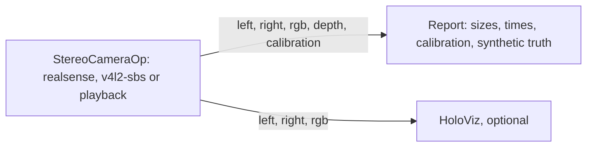

# Stereo Camera

The demo of `StereoCameraOp` from the [holoscan-stereo-camera](../../modules/stereo-camera/)
module. The operator reads a RealSense, a side-by-side V4L2 camera or a recording, and a reporter
takes each frame's left, right, RGB and depth images and calibration together and checks them. A
HoloViz window can show the left and right images side by side, with the RGB image under them. It
uses the installed module the way any other project would: `find_package(holoscan-stereo-camera)`.



## Requirements

- holoscan-stereo-camera, installed (see [its README](../../modules/stereo-camera/README.md)), and
  what it needs: Holoscan SDK 5.0 with Core and Sensor I/O (and Visualization for the window), CMake
  4.0 or later and a C++20 compiler.
- For the `realsense` mode, a RealSense and the module built with librealsense; for `v4l2-sbs`, a
  side-by-side camera and its calibration file; for the window, a display.

The `ci` mode needs no camera and no data: it writes a synthetic recording and plays it.

## Build and run

From the repository root, after installing the module into `install/`:

```bash
cmake -S applications/stereo_camera -B build/stereo_camera -G Ninja \
  -DCMAKE_BUILD_TYPE=Release -DCMAKE_PREFIX_PATH="$PWD/install"
cmake --build build/stereo_camera
build/stereo_camera/stereo_camera --source realsense --print-calibration true   # realsense mode
build/stereo_camera/stereo_camera --source playback --synthetic synthetic_recording \
  --count 30 --period-ms 5 --display false                                     # ci mode
```

The modes in [metadata.json](metadata.json):

| Mode | Behavior |
| --- | --- |
| `realsense` (default) | The first RealSense's infrared pair and color image, projector on, 300 frames in the window, with the factory calibration printed |
| `v4l2-sbs` | A side-by-side camera at `/dev/video0`, 2560x720 YUYV, with the calibration file `<holohub_data_dir>/stereo_camera/calibration.json` |
| `playback` | The recording `<holohub_data_dir>/stereo_camera/recording`, once |
| `ci` | 30 frames of a synthetic recording written at run time, with RGB and depth, every image checked against the synthetic camera; a finite headless check that CI runs |

`--source realsense` takes the camera's options: `--emitter false` turns the projector off,
`--depth true` adds the depth image, `--width`, `--height` and `--fps` choose the infrared mode,
`--rgb-width` and `--rgb-height` the color mode, `--serial` the camera. `--source playback
--recording DIR` plays a recording, such as one `stereo_camera_record` wrote; `--loop true` plays
it again until `--count`. `--device-output true` sends the images in GPU memory, and `--display`
turns the window on or off (by default it is on for a live camera when there is a display).
`--help` lists every option.

A live camera is connected with drop-oldest edges: the reporter and the window take the newest
frame when they are ready, and never hold the camera back. A recording plays losslessly, every
frame in order.

## Output

Each run prints the frames, the source and camera, the eyes' size and format, the baseline and the
left eye's focal length, and the RGB and depth images with the share of pixels with a depth. Then
what the reporter checked: eyes of the calibration's size and of the same format, increasing frame
ids, capture times and camera timestamps, no frame missing from a recording, the same calibration
throughout and, for a synthetic recording, every image against the synthetic camera.
`--print-calibration true` also prints the calibration as a recording's `calibration.json`. Then
comes a `verdict`: `PASS`, `FAIL`, or `STOPPED` when an interrupt or the window ends the run early.
It exits 0 on `PASS`, 2 for invalid options, else 1:

```text
stereo_camera: frames=30/30 source=playback camera="synthetic" eyes=320x240 mono8 baseline_mm=100.000 fx=256.000 rectified=1 rgb=320x240 rgb8 depth=320x240 mono16 depth_scale_mm=1.000 valid_depth=100.000% wrong_sizes=0 not_increasing=0 frame_gaps=0 calibration_changes=0 truth: verified=30 wrong_images=0
stereo_camera: verdict=PASS
```

## Tests

With `-DBUILD_TESTING=ON`, `ctest` runs the demo on synthetic recordings, with and without RGB and
depth, in host and GPU memory, at 1280x720 and looped, every image against the synthetic camera; a
recording played back with its calibration printed; a recording with a broken frame, which fails
naming the file; a missing V4L2 camera, which fails at start; the display's graph; invalid options;
and a run without managed signal handling. The tests of the recordings of a real RealSense run when
`HOLOSCAN_TEST_DATA` names a folder with them in `stereo-camera/`, and are skipped otherwise. None
needs a camera.

## Licenses

Apache-2.0. The module's README lists the licenses of what it uses.
