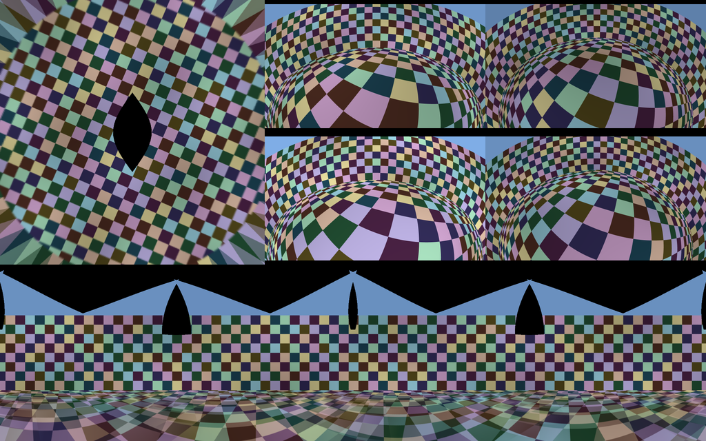

# Stitching

The demo of the [holoscan-stitching](../../modules/stitching/) module. Four synthetic fisheye
cameras (1280x720, about 215 degrees across) sit on a 4 m x 2 m vehicle, as surround-view systems
mount them, and the vehicle drives around a circle through a world of a checkered ground and a
checkered cylindrical wall that moves with it. One `StitchOp` makes a 1024x1024 bird's-eye view of
the ground 5.5 m around the vehicle; another a 4096x1024 cylindrical panorama of the wall, seen
from 1 m above the vehicle's centre. HoloViz shows both and the four cameras, in a window or
rendered offscreen into CUDA memory. Headless and offscreen, every output is checked against the
ground truth rendered directly from the world. It uses the installed module the way any other
project would: `find_package(holoscan-stitching)`.



An offscreen render (shown at half size) with exposure compensation of cameras at exposures 1,
0.85, 1.15 and 0.95. Top left, the bird's-eye view, with the patch under the vehicle that no camera
sees and, in its corners, the wall beyond 6 m smeared over the ground; top right, the cameras; below,
the panorama. The wall is exact; the ground below it is seen by cameras 2 to 4 m apart, so its
overlaps show parallax, as any panorama of cameras that do not share a centre does, and above the
cameras' view it is black.

## Requirements

- holoscan-stitching, installed (see [its README](../../modules/stitching/README.md)), and what it
  needs: Holoscan SDK 5.0 with Core, Sensor I/O and Visualization, CUDA 13, CMake 4.0 or later and a
  C++20 compiler.
- A display for the window; the offscreen and headless modes need none.

## Build and run

From the repository root, after installing the module into `install/`:

```bash
cmake -S applications/stitching -B build/stitching_app -G Ninja \
  -DCMAKE_BUILD_TYPE=Release -DCMAKE_PREFIX_PATH="$PWD/install"
cmake --build build/stitching_app
build/stitching_app/stitching --display window                                       # window mode
build/stitching_app/stitching --count 60 --period-ms 10 --display offscreen          # offscreen mode
build/stitching_app/stitching --count 30 --period-ms 10 --exposure true \
  --camera-gains 1,0.85,1.15,0.95 --display none                                     # ci mode
```

`--help` lists the options: a rig file to render instead of the built-in rig (`--rig`), the
cameras' size and exposures, the outputs' sizes, the blend (`feather` or `hard_seam`, with a
feather cap), exposure compensation, and `--image-dir DIR` to write each offscreen render as a PPM
file. `-DSTITCHING_APP_ENABLE_VISUALIZATION=OFF` builds it without HoloViz.

The modes in [metadata.json](metadata.json) are the three commands above:

| Mode | What it does |
| --- | --- |
| `window` | Live, at 30 frames per second until the window is closed. Every edge keeps only the newest frame (`QueuePolicy::kDropOldest`, depth 1), so a slow display never holds back the cameras. Nothing is checked. |
| `offscreen` | HoloViz renders into CUDA memory instead of a window. Every frame's outputs are checked, and every render must show a picture in each of its six tiles. |
| `ci` | Headless and finite, the check CI runs: 30 frames of the moving rig, its cameras at different exposures, with exposure compensation, both outputs checked. |

Outside the window, the cameras keep one frame in flight: they send the next once the last one's
outputs are checked, so nothing is dropped.

## The checks

Each frame's outputs are compared with the truth of the rig's pose
(`compare_with_truth()` of the module), over the pixels that a camera sees and that show the
surface the projection assumes (the ground in the bird's-eye view, the wall in the panorama). A
frame passes when, for each output:

| | Bird's-eye view | Panorama |
| --- | ---: | ---: |
| PSNR, after scaling the truth by the ratio of the means | 26 dB | 28 dB |
| Coverage of the comparable pixels | 90% | 90% |
| Checkerboard corners checked | 50 | 50 |
| Largest corner error, stitch against truth | 1 px (1.5 with hard seams) | 1 px (1.5 with hard seams) |
| Ratio of the means, off 1 by at most | 0.02 (0.1 with compensation) | 0.02 (0.1 with compensation) |

Corners are refined in both images as OpenCV's `cornerSubPix` does, where the cameras resolve at
least a quarter of a camera pixel per output pixel: on the bird's-eye view's far edges a camera
pixel spans up to seven output pixels, and no stitch can place a corner there to one. A hard seam
through a corner joins two cameras' differently blurred halves, which moves it by up to about 1.2
pixels. Without compensation, cameras at different exposures fail the brightness check (a test
makes sure of that).

## Output

A headless or offscreen run prints the worst of every frame's comparisons and `PASS` or `FAIL`. It
exits 0 on `PASS`, 2 for invalid options, else 1:

```text
stitching: 4 cameras, birds_eye 1024x1024, cylindrical 4096x1024, blend feather with exposure compensation
stitching: frames=30/30 birds_eye: psnr>=28.099 coverage>=0.969 corners>=273 corner_error<=0.782 gain_error<=0.039 panorama: psnr>=31.912 coverage>=0.976 corners>=484 corner_error<=0.661 gain_error<=0.046
stitching: verdict=PASS
```

That is the `ci` mode on x86_64 (GeForce RTX 5090).

## Tests

`ctest` in the build folder runs the demo headless with feathering, with exposure compensation and
with hard seams, every output checked; checks that different exposures without compensation fail;
runs it offscreen, every render checked; compiles the window graph; and checks that bad options
exit with a usage error.
