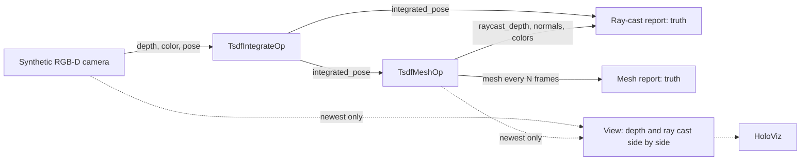

# TSDF Reconstruction

The demo of the [holoscan-tsdf](../../modules/tsdf/) module. A synthetic RGB-D camera circles a
known tabletop scene (a floor, a box standing on it and a sphere floating above it) with known
poses, with depth noise of 1 mm plus 2 mm per square meter. `TsdfIntegrateOp` integrates every
frame, with its color, into a TSDF volume; `TsdfMeshOp` ray casts the volume from each pose and
extracts its mesh every N frames. Reporters check every ray cast against the scene's exact depth
and every mesh against its exact surfaces, and HoloViz shows the input depth beside the shaded ray
cast. It uses the installed module the way any other project would: `find_package(holoscan-tsdf)`.



## Requirements

- holoscan-tsdf, installed (see its README), and what it needs: Holoscan SDK 5.0 with Core and
  Sensor I/O (Visualization for the display), CUDA 13, CMake 4.0 or later and a C++20 compiler.
- About 300 MiB of GPU memory for the default 256^3 volume with color and its mesh; 512^3 needs
  about 1.6 GiB.

The demo downloads nothing and needs no models or data: it renders its frames.

## Build and run

From the repository root, after installing the module into `install/`:

```bash
cmake -S applications/tsdf_reconstruction -B build/tsdf_reconstruction -G Ninja \
  -DCMAKE_BUILD_TYPE=Release -DCMAKE_PREFIX_PATH="$PWD/install"
cmake --build build/tsdf_reconstruction
build/tsdf_reconstruction/tsdf_reconstruction --count 240                     # synthetic mode
build/tsdf_reconstruction/tsdf_reconstruction --count 60 --orbit 60 --mesh-every 20 \
  --period-ms 10 --display false                                              # ci mode
```

| Option | Default | |
| --- | --- | --- |
| `--count N` | `240` | Frames |
| `--orbit N` | `120` | Frames per orbit of the scene |
| `--period-ms N` | `33` | Camera period, 1..1000 ms |
| `--width N --height N` | `640 480` | Image size, 64x48 to 4096x4096 |
| `--dims N` | `256` | A volume of `N^3` voxels over the scene's meter, 32..512 |
| `--mesh-every N` | `30` | Extract the mesh every N frames |
| `--depth mm\|m` | `mm` | uint16 millimeters or float32 meters |
| `--ply PATH` | | Save the final mesh as a PLY file |
| `--display auto\|true\|false\|offscreen` | `auto` | Show the depth and the ray cast in HoloViz; `auto` when `DISPLAY` or Wayland is set; `offscreen` renders into CUDA memory and checks what was rendered |
| `--timeout-seconds N` | `120` | Allowance beyond the expected run time |
| `--compile-only true\|false` | `false` | Build and check the graph without running it |

| CMake option | Default | |
| --- | --- | --- |
| `TSDF_RECONSTRUCTION_ENABLE_VISUALIZATION` | `ON` | Build the HoloViz display |
| `BUILD_TESTING` | `OFF` | Build the demo's tests |

The window shows each frame twice side by side: on the left the camera's depth, red near and blue
far, black where there is none; on the right the volume ray cast from the same pose, lit from the
camera, in the colors it has gathered. Only what lies inside the volume (a meter around the scene)
appears on the right.

The operators cannot send a refused output again, so the camera keeps one frame in flight: it
renders the next frame only once the ray-cast reporter has counted the previous one, and no
lossless queue ever fills. The display branch keeps only the newest frame
(`QueuePolicy::kDropOldest`, depth 1), so it never holds the pipeline back.

## What it checks

- Every ray cast from the camera's pose, after the first 10 frames, against the scene's exact
  depth, on the surfaces inside the volume: median error at most half a voxel, 95th percentile at
  most 1.5 voxels, at most 2 % of hits more than three voxels off (rays grazing an edge), at least
  95 % of the surfaces seen; every hit with a unit normal facing the camera, and nearly every hit
  with a color.
- Every mesh: no capacity overflow, every triangle indexing written vertices, every vertex with a
  unit normal; and the last mesh's vertices within 0.35 voxels of the exact surfaces on average and
  one voxel at the 95th percentile.

It prints, for example (x86_64, the `ci` mode, a 256^3 volume of 3.92 mm voxels):

```text
tsdf_reconstruction: volume 256^3, 3.92 mm voxels, 192 MiB on the GPU
tsdf_reconstruction: frames=60/60 fps=32.95 raycast: worst_median_mm=0.33 worst_p95_mm=1.42 worst_outliers=1.07% worst_coverage=98.51% bad_hits=0 meshes=3/3 mesh: vertices=109861 triangles=216760 mean_mm=0.25 p95_mm=0.69 max_mm=2.73 overflows=0 bad_triangles=0 bad_normals=0 voxel_mm=3.92
tsdf_reconstruction: verdict=PASS
```

The frame rate is set by the camera's period and the reporters, which compute the exact depth of
every pixel on the CPU; the GPU work per frame is about a millisecond (see the module's README).
The `ci` mode passes only when every check passes. A stop request (Ctrl+C) ends the run with
`verdict=STOPPED`.

## Tests

With `-DBUILD_TESTING=ON`, `ctest --test-dir build/tsdf_reconstruction` runs the demo with float32
depth, at 1280x720, with a mesh every frame and with a PLY file saved, all checked against the
truth; renders both views offscreen in HoloViz and checks the frames; compiles the window display
graph without a display; and checks that unusable arguments are usage errors.

## Licenses

Apache-2.0, like the module it uses. See its NOTICE file.
