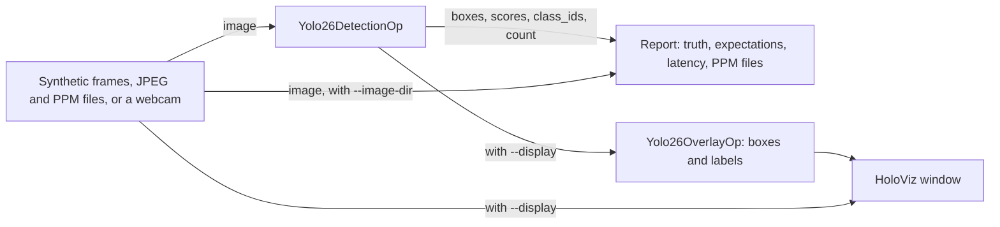

# YOLO26 Detection

The demo of the [holoscan-yolo26](../../modules/yolo26/) module. A source (synthetic frames with
known detections, JPEG and PPM files, or a live V4L2 webcam) feeds `Yolo26DetectionOp`, whose
detections a reporter checks, prints and times, and can draw onto the images, which it writes as
PPM files. A HoloViz window can show the frames with `Yolo26OverlayOp`'s boxes and labels drawn
over them. It uses the installed module the way any other project would:
`find_package(holoscan-yolo26)`.

> **The model is AGPL-3.0.** YOLO26 weights and the Ultralytics software that exports them are
> licensed under the
> [GNU Affero General Public License v3.0](https://github.com/ultralytics/ultralytics/blob/main/LICENSE)
> (or an Ultralytics Enterprise License). Neither is part of this repository, which is Apache-2.0
> and contains no Ultralytics code or weights. They are downloaded and exported separately, on your
> machine, by the module's `prepare_model.py` (see "Prepare the model" below); the terms that apply
> to using and distributing the model and anything built with it are yours to review. The tests and
> the `ci` mode need neither: they use the module's stand-in model.



## Demo

Videos of the demo on synthetic input and on real input go in [tests/video](tests/video).

## Requirements

- holoscan-yolo26, installed (see [its README](../../modules/yolo26/README.md)), and what it needs:
  Holoscan SDK 5.0 with Core, Sensor I/O, Inference and Visualization (Testing for the tests),
  CUDA 13 with nvJPEG, CMake 4.0 or later and a C++20 compiler.
- For the `camera` mode: a V4L2 webcam offering YUYV, and a display.
- For the real model only: the model prepared as below.

## Prepare the model

The `demo`, `files` and `camera` modes and the real-model tests need YOLO26n exported to ONNX with
its end-to-end head, and the COCO validation image `000000039769.jpg` (subject to the COCO terms of
use, on the Terms of Use page at [cocodataset.org](https://cocodataset.org/)). The module's
[`prepare_model.py`](../../modules/yolo26/tools/prepare_model.py) downloads and checks both, and
exports the model with the Ultralytics `yolo` command, which you install in a virtual environment of
its own; its README explains the steps and their risks. From the repository root:

```bash
python3 -m venv ~/ultralytics-venv
~/ultralytics-venv/bin/pip install ultralytics onnx onnxslim onnxruntime
python3 modules/yolo26/tools/prepare_model.py --output data/yolo26_detection \
  --yolo ~/ultralytics-venv/bin/yolo
```

This writes `data/yolo26_detection/yolo26n.onnx`, `yolo26n.labels.txt` and
`images/000000039769.jpg`, where the modes and the tests look for them. Copy your own JPEG or PPM
images into `data/yolo26_detection/images` for the `files` mode.

## Build and run

From the repository root, after installing the module into `install/`:

```bash
cmake -S applications/yolo26_detection -B build/yolo26_detection -G Ninja \
  -DCMAKE_BUILD_TYPE=Release -DCMAKE_PREFIX_PATH="$PWD/install"
cmake --build build/yolo26_detection
```

The modes in [metadata.json](metadata.json) are these commands, where `<holohub_data_dir>` is the
repository's `data` folder:

| Mode | Behavior |
| --- | --- |
| `demo` (default) | YOLO26n on the prepared images, 300 frames looped, printing each image's detections once and the latency. |
| `files` | YOLO26n on each image in `data/yolo26_detection/images` once, printing the detections and writing each image with its boxes drawn. |
| `camera` | YOLO26n on a live webcam, with the detections drawn over it in a HoloViz window. |
| `ci` | 30 synthetic BGR8 frames through TensorRT with the stub model, every detection checked against the frame's known ones. Needs no download; CI runs it. |

```bash
build/yolo26_detection/yolo26_detection --model data/yolo26_detection/yolo26n.onnx \
  --labels data/yolo26_detection/yolo26n.labels.txt --source files \
  --images data/yolo26_detection/images --loop true --count 300 --period-ms 10   # demo mode
build/yolo26_detection/yolo26_detection --model stub --count 30 --period-ms 5 --encoding bgr8  # ci mode
```

The `demo` mode prints, for the COCO image:

```text
yolo26_detection: 000000039769.jpg: 4 detections
  cat (15) 0.912 [344.0, 24.6, 640.0, 374.9]
  cat (15) 0.898 [6.9, 55.1, 317.2, 466.1]
  remote (65) 0.857 [40.4, 74.0, 175.9, 118.6]
  couch (57) 0.297 [0.8, 0.6, 640.0, 480.0]
yolo26_detection: frames=300/300 detections=1200 latency_ms: mean=1.390 p50=1.268 p99=2.043 max=25.490
yolo26_detection: verdict=PASS
```

The latency is the time from a frame's capture by the source to its detections on the host,
including the JPEG decode; the first frame's includes the warm-up. The first run builds the TensorRT
engine from the ONNX file, which takes 10 to 30 s, and caches it beside the file; later runs start
in seconds.

`--model stub` writes and uses the module's stand-in model: an ONNX network with the inputs and
outputs of an end-to-end YOLO26 export that "detects", from the pixels, red (class 0) and blue
(class 1) regions, so the synthetic frames' red and blue rectangles. It is written to the working
directory, where its engine is cached too. With it, each synthetic frame's detections are checked
against the rectangles: each box edge within a model input pixel or so (`2 / r + 1` image pixels),
the exact score, and nothing extra.

Each run prints the frame count, the detections, the latency and, as they apply, the truth check and
the expected detections found. A gap in the frame ids fails the run, as does a run over files with
nothing expected and no detection at all, which most likely means a wrong model, input size or
threshold. Then comes a `verdict`: `PASS`, `FAIL`, or `STOPPED` when an interrupt or a closed window
ends the run early. It exits 0 on `PASS`, or on `STOPPED` for a camera run without `--count`; 2 for
invalid options, a missing camera among them; else 1.

`--expect FILE` lists detections that named image files must yield, as lines of
`image,class_id,x1,y1,x2,y2`, each matched by a detection of the class with an IoU of at least
`--expect-iou` (default 0.8). `--image-dir DIR` writes each frame with its boxes drawn as
`DIR/detections_NNNNNN.ppm`. Synthetic frames and files go one at a time: the source sends a frame
only once the reporter is done with the one before, so none is lost however long the reporter takes,
to write an image say, and `--period-ms` is the shortest time between frames. `--encoding bgr8` decodes the files as BGR8, `--fp16 true` builds an
FP16 engine, and `--score-threshold` sets the threshold. Run the executable with `--help` for every
option. `-DYOLO26_DETECTION_ENABLE_VISUALIZATION=OFF` builds it without HoloViz.

### Webcam

Allow the window to open, then run the `camera` mode:

```bash
xhost +local:
build/yolo26_detection/yolo26_detection --model data/yolo26_detection/yolo26n.onnx \
  --labels data/yolo26_detection/yolo26n.labels.txt --source camera --device /dev/video0
```

The camera is opened when the run starts and closed when it stops; frames that arrive while the
detector is busy are dropped, so each detection is of the newest frame. The window shows each frame
with its boxes, a color per class, and a `<class> 0.87` label above each box. The camera must offer
YUYV at the requested size (default 640x480, or for example `--width 1280 --height 720`); otherwise
the run stops with the sizes it offers. To use another camera, list them with
`v4l2-ctl --list-devices` and pass one with `--device /dev/videoN`. The run lasts until Ctrl+C or the
window is closed. `--display true` shows synthetic frames too, and `--display false` runs the camera
without a window.

## Performance

On an RTX 5090 (driver 595.91.07, shared with another process) with SDK 5.0.0, CUDA 13.2 and
TensorRT 10.16, for YOLO26n at 640 on the 640x480 COCO image, it takes a median of 1.27 ms from
capture to detections on the host with the FP32 engine, and 0.96 ms with FP16, the source's JPEG
decode included. The module's README breaks down the GPU work per frame, measured with Nsight
Systems over 300 frames, tracing CUDA graph nodes, from:

```bash
nsys profile -t cuda --cuda-graph-trace=node --sample=none --cpuctxsw=none -o yolo26 \
  build/yolo26_detection/yolo26_detection --model data/yolo26_detection/yolo26n.onnx \
  --source files --images data/yolo26_detection/images --loop true --count 300 --period-ms 10
```

## Tests

With `-DBUILD_TESTING=ON`, `ctest` checks:

- The demo with the stub model on synthetic frames and on JPEG (baseline and progressive) and PPM
  files that a fixture writes: every encoding, GPU and host memory, wide, tall and small frames,
  another input size, FP16 engines, engine files, image output, expected detections, and the exit
  status and verdict of failed, stopped and invalid runs, a run without managed signal handling, a
  missing camera, and the display graph.
- With the real model, the two cats and the remote that the Ultralytics predictor finds in the COCO
  image, in RGB8 and BGR8, with an FP16 engine and looped. These run when the model has been
  prepared in `data/yolo26_detection`, and are reported as skipped otherwise; point them elsewhere
  with `-DYOLO26_DATA_DIR=/path/to/prepared`.
- Without a GPU: the expectation and label files, image headers, PPM files and box drawing; and,
  also built on its own from `tests/host/` by the hosted CI job, the webcam's YUYV conversion.

The module's own suite tests the kernels and the operators.

## Licenses

Apache-2.0. The YOLO26 model is not covered by it; see the note at the top. The module's README
lists the licenses of what it uses.
